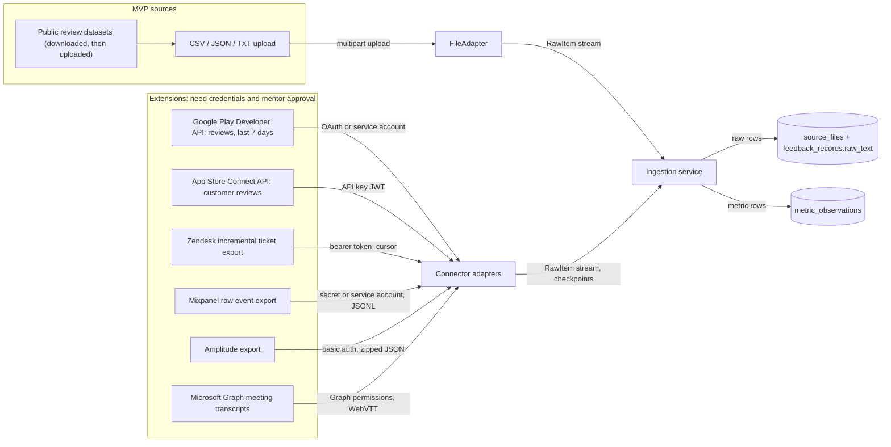
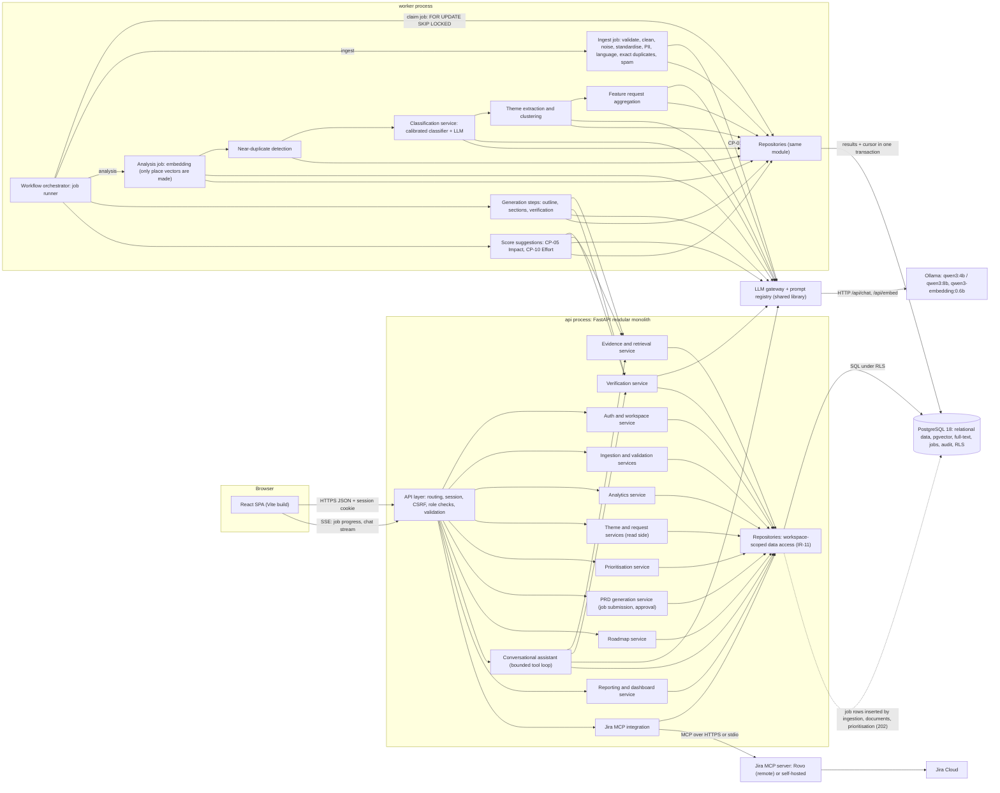

# 01 · High-Level Design

Where the data comes from, where it goes, which components process it, and why this shape fits a five-person team, eight weeks and one laptop.

Basis labels: [V] verified on 20 Nov 2026 (doc 11 §2), [E] estimate, [3P] third-party or general knowledge not verified in this session, [D] design decision.

## 1. Architectural style

| Option | Fit for this project | Verdict |
|---|---|---|
| Modular monolith (one deployable, strict module boundaries) | One codebase and one process to debug; module boundaries keep it maintainable; runs in limited RAM | **Selected** (ADR-01) |
| Microservices | Network failures, service discovery, distributed tracing and multiple processes on a RAM-limited laptop; no team-scaling benefit for five people | Rejected |
| Event-driven with a message broker | Decoupling is useful, but a broker (Redis, RabbitMQ, Kafka) is another always-on service; PostgreSQL can act as a durable job queue at our volume | Rejected; PostgreSQL job table used instead (ADR-05) |
| Layered architecture inside each module | API → service → repository → database, with a domain model per module | **Selected** as the internal structure of each module |
| Hybrid synchronous and asynchronous processing | Short requests and deterministic scoring are synchronous; imports, analysis, generation and AI score suggestions are asynchronous jobs; the assistant runs in-request under a 5-minute deadline | **Selected** |

## 2. Deployment view (processes on the reference laptop)

| Process | Contains | Always on in demo mode |
|---|---|---|
| `api` (FastAPI, Uvicorn) | API layer, all domain modules, assistant loop, serves the built React app | Yes |
| `worker` (Python) | Job runner executing pipeline, analysis, generation and connector jobs | Yes |
| `postgres` (PostgreSQL 18 + pgvector) | All persistent state, job queue, vectors, full-text indexes, audit | Yes |
| `ollama` | Language and embedding models on the RTX 4060 | Yes |
| MCP server (only for the fallback option in ADR-15) | Self-hosted Jira MCP server, started on demand by the integration component | No |

Four always-on services satisfies NFR-07.

## 3. External data sources

### 3.1 Source integration matrix

"MVP" means part of the first implementation. "Extension" means designed through the adapter interface (§3.2) but not built unless the mentor approves and credentials exist.

| Source | Data available | Access method | API | Authentication | MVP or extension | Limitations |
|---|---|---|---|---|---|---|
| **User-uploaded CSV, JSON, TXT** | Reviews, tickets, requests, transcripts, metrics | File upload | Our API (doc 09) | Our session | **MVP** | Up to 20 MB per file (A-06) |
| Public review datasets (for example from Kaggle or Hugging Face) | App or product reviews | Downloaded file, then uploaded | None | None | **MVP data source** (A-01) | Licence of each dataset must be checked |
| Google Play reviews | Reviews with text, rating, app version, device | REST: `GET /applications/{package}/reviews` (up to 100 per page) [V] | Google Play Developer API | OAuth client or service account with the "Reply to reviews" permission [V] | Extension | Only reviews created or modified in the last 7 days, only reviews with comments, production track only, 200 GET requests per hour per app [V]. A connector must sync at least weekly or reviews are lost; older reviews come from the Play Console CSV download [V] |
| Apple App Store reviews | Rating, title, body, territory, date | REST: list customer reviews for an app or app version; read one review [V] | App Store Connect API | JWT signed with an App Store Connect API key [3P] | Extension | Requires App Store Connect team access; exact roles not verified |
| Zendesk tickets | Tickets with comments and metadata | Cursor-based incremental export `GET /api/v2/incremental/tickets/cursor` [V] | Zendesk Support API | Bearer token; endpoint allowed for admins [V] | Extension | 10 requests per minute; up to 1,000 tickets per page [V] |
| Other help desks (Freshdesk, Intercom, Jira Service Management) | Tickets, conversations | REST APIs | Vendor APIs | Vendor tokens | Extension | Not verified in this session |
| Feature-request portals (for example Canny, Productboard) | Requests, votes | REST APIs | Vendor APIs | Vendor tokens | Extension | Not verified in this session |
| Mixpanel | Raw events (JSONL) | `GET https://{data,data-eu,data-in}.mixpanel.com/api/2.0/export` with `from_date`, `to_date` [V] | Raw Event Export API | Project secret (basic auth) or service account with `project_id` [V] | Extension | 60 queries per hour, 3 per second [V]; raw events must be aggregated into metrics before use |
| Amplitude | Raw events (zipped, gzip JSON per line) | `GET https://amplitude.com/api/2/export` with `start`, `end` as `YYYYMMDDTHH` [V] | Export API | Basic auth with API key and secret [V] | Extension | Up to 365 days per request; 6 GB cap; data available up to 2 hours after receipt [V] |
| Google Analytics 4, PostHog | Aggregated reports or events | Vendor APIs | Vendor APIs | OAuth or service account (GA4), API key (PostHog) | Extension | Not verified in this session |
| Microsoft Teams transcripts | Meeting transcripts (WebVTT with speaker tags) | `GET /users/{userId}/onlineMeetings/{meetingId}/transcripts/{transcriptId}/content` [V] | Microsoft Graph | `OnlineMeetingTranscript.Read.All` (delegated or application); application access needs a tenant application access policy [V] | Extension | Tenant admins can disable transcript access or speaker attribution; not available for live events [V] |
| Zoom transcripts | VTT transcript files | Recording APIs | Zoom APIs | OAuth | Extension | The verified Zoom page covers the Video SDK and a credit plan [V]; meeting-recording transcript access was not verified |
| Jira (output, not a source) | Create issues from approved stories | MCP tools (doc 01 §5) | Atlassian Rovo MCP server or self-hosted MCP server | OAuth 2.1 or API token [V] | Should (AGR-12 to AGR-25) | See ADR-15 |

**No direct database access to any source system is assumed.** All extensions use the vendors' public APIs and need an account, credentials and mentor approval (AR-05).

### 3.2 Adapter architecture

Every source, MVP or future, is an adapter that produces the same raw item format, so the pipeline never changes when a source is added.

```text
SourceAdapter (interface)
  kind: "file" | "google_play" | "app_store" | "zendesk" | "mixpanel" | "amplitude" | "ms_graph_transcripts" | ...
  describe() -> AdapterSpec            # fields offered, auth type, rate limits, required config keys
  validate_config(config) -> list[Problem]
  fetch(since: Cursor | None) -> Iterator[RawItem]   # pulls pages, honours rate limits and Retry-After
  checkpoint() -> Cursor               # stored in data_sources.sync_state after each committed page

RawItem: {source_record_id, text_fields{...}, occurred_at, customer_ref, rating?, version?, metadata{...}}
```

- The MVP implements only `FileAdapter` (CSV, JSON, TXT through column mapping).
- Connector adapters run as jobs of type `source_sync`. A scheduled sync is Future. Google Play's 7-day window needs at least weekly syncing [V].
- Credentials live encrypted in `integration_configs`; adapters receive them from the integration service, never from the client.

### 3.3 External source integration diagram



## 4. Overall architecture



## 5. Components

Each component maps to low-level services in doc 03 (SVC-xx). Communication: **in-process** (Python call inside one process), **job** (row in `jobs`, picked up by the worker), **HTTP** (to Ollama or external), **SSE** (server-sent events to the browser).

| ID | Component | Responsibility | Inputs | Outputs | Dependencies | Database | Comms | Failure handling | SRS |
|---|---|---|---|---|---|---|---|---|---|
| CMP-01 | Frontend (React SPA) | All screens; client validation; evidence drawer; claim statuses | User actions | API calls | CMP-03 | None | HTTPS, SSE | Error states with retry and correlation ID | IR-01 to IR-03, NFR-16 to NFR-20 |
| CMP-02 | Authentication and workspace service | Register, sign in and out, sessions, throttling, workspaces, membership, roles | Credentials, workspace data | Session, membership context | CMP-24 | users, sessions, login_attempts, workspaces, workspace_memberships | In-process | Generic auth errors; throttling | FR-AUTH-01 to FR-AUTH-12, SEC-01 to SEC-06 |
| CMP-03 | API layer | Routing, request validation, session loading, CSRF, role checks, setting the RLS workspace variable, error format, OpenAPI | HTTP requests | JSON responses, SSE | CMP-02 | Sets `app.workspace_id` per transaction | HTTPS | Consistent error envelope | IR-04 to IR-07, SEC-03 to SEC-05 |
| CMP-04 | Data source connectors | Adapter interface; FileAdapter in MVP; connector adapters later | File or connector config | RawItem stream | CMP-23 (credentials), CMP-05 | data_sources, integration_configs | In-process within jobs | Rate-limit backoff; checkpoints | FR-ING-01, DR-01, CR-10 |
| CMP-05 | Ingestion service | Upload handling, column mapping, job creation, raw storage, import status and report | Upload, mapping | import_jobs, source_files, raw records | CMP-04, CMP-06, CMP-07, CMP-10 | source_files, column_mappings, import_jobs, import_row_errors, feedback_records | In-process, job | Record-level isolation; retry without duplicates | FR-ING-01 to FR-ING-12, DR-02, DR-31 to DR-40 |
| CMP-06 | Validation service | File type, size, encoding, schema and row validation | File, mapping | Accepted rows, row errors | None | import_row_errors | In-process | Rejects with row and reason | DR-05 to DR-10 |
| CMP-07 | Raw data storage | Immutable copy of every upload and row | Files, rows | source_files (path, hash), raw_text | Filesystem, CMP-24 | source_files, feedback_records | In-process | Stored outside served paths | DR-33, DR-35, SEC-11 |
| CMP-08 | Preprocessing pipeline | Canonical order (doc 06 §1): clean, noise, standardise and customer key, PII masking, language, exact duplicates, spam | Raw records | Prepared records, one outcome each | CMP-09, CMP-12 (CP-01) | feedback_records, customers | Job | Per-stage idempotent; failures listed | DR-11 to DR-25 |
| CMP-09 | PII masking service | Detect and mask PII with typed placeholders | Text | Masked text, entity counts | Presidio | feedback_records | In-process | Fail closed: record not analysable if masking fails | DR-28 to DR-30, NFR-21 |
| CMP-10 | Background worker | Claim and run jobs; heartbeat; resume | Job rows | Updated rows | CMP-22 | jobs | Job | Resume from cursor; stale-lock recovery | DR-36 to DR-39, NFR-10 |
| CMP-11 | Embedding service | Batch embeddings through the gateway inside the analysis job (step 1) and query embeddings for retrieval; never during ingestion | Processed text | Vectors | CMP-12 | record_embeddings | In-process within the analysis job | Retry batch; then `embedding_failed` for that run | DR-26 |
| CMP-12 | LLM gateway | Only path to models: routing, schemas, `think`, timeouts, retries, logprobs, call records | Task, messages, schema or tools | Validated output | Ollama, prompt registry | llm_call_records, prompt_versions | HTTP | Retry with validation feedback; fail visibly | AIR-09 to AIR-12, AIR-21, AIR-22, IR-08 |
| CMP-13 | Classification service | Category, sentiment, sarcasm flag; cascade and calibration | Masked records, embeddings | record_classifications, review_items | CMP-12, CMP-11 | record_classifications, review_items | In-process within jobs | Low confidence to review | FR-THM-01, FR-THM-02, FR-THM-08, FR-THM-10, AIR-01, AIR-02 |
| CMP-14 | Theme extraction service | Clustering, theme identity across runs, naming, statistics, overrides | Embeddings, classifications | themes, memberships | CMP-12 | themes, theme_memberships, theme_overrides, analysis_runs | Job | Keeps previous run visible if a run fails | FR-THM-03 to FR-THM-12, AIR-03, AIR-04 |
| CMP-15 | Feature request aggregation service | Canonical asks, grouping, borderline checks, counts | Feature-request records | aggregated_requests, memberships | CMP-12, CMP-11 | aggregated_requests, request_memberships | Job | Previous groups kept on failure | FR-AGG-01 to FR-AGG-07 |
| CMP-16 | Product analytics service | Metric import, releases, links, trends, conflict detection, spike detection | Metric rows, themes | Trends, conflicts | CMP-24 | metric_definitions, metric_observations, product_releases, theme_metric_links | In-process, job | Invalid rows rejected | FR-ANA-01 to FR-ANA-06, DR-41 |
| CMP-17 | Evidence and retrieval service | Hybrid retrieval, evidence packs, per-customer cap, citation resolution | Query, filters | Ranked evidence with IDs | CMP-11, CMP-24 | feedback_records, record_embeddings | In-process | Empty result is a valid result | AIR-05 to AIR-07, NFR-17 |
| CMP-18 | Prioritisation service | Opportunities, RICE/ICE, provenance and history, ranking, explanations (synchronous); AI suggestions through a `suggest_inputs` job | Themes, requests, inputs | Scores, rankings | CMP-22 (job), CMP-12 (CP-05, CP-10 in the worker) | opportunities, scoring_configs, score_inputs, score_snapshots | In-process; job for suggestions | Incomplete items excluded with reason | FR-PRI-01 to FR-PRI-11, AIR-08 |
| CMP-19 | PRD generation service | Evidence assembly, outline, sections, stories, criteria, versions | Opportunity | Draft documents | CMP-17, CMP-20, CMP-12 | documents, document_versions, user_stories, acceptance_criteria, claims, claim_evidence | Job | Failed sections marked | FR-DOC-01 to FR-DOC-12, FR-DSH-03 |
| CMP-20 | Verification service | Evidence-ID, quotation and number checks; support check; statuses | Claims, evidence | verification_results | CMP-12 (CP-07) | claims, verification_results | In-process | Unverifiable is shown as "not checked" | AIR-13 to AIR-18, SEC-13 |
| CMP-21 | Conversational assistant | Bounded tool loop over read-only tools; cited answers; refusals | Question | Answer, citations | CMP-12, CMP-17, CMP-20 | chat_sessions, chat_messages, tool_call_records | In-process, SSE | Stops at limits with a partial, honest answer | FR-AST-01 to FR-AST-10, AGR-06 to AGR-11 |
| CMP-22 | Workflow orchestrator | Job types, step cursors, retries, timeouts, approval states, resumption | Jobs | State transitions | CMP-24 | jobs, documents.status, integration_actions | Job | Idempotent steps; dead-letter after limits | AGR-01 to AGR-05 |
| CMP-23 | Jira MCP integration | Credentials, preview, approval, MCP calls, external links, duplicate prevention | Approved stories | Jira keys | MCP SDK, MCP server | integration_configs, integration_actions, external_item_links, approvals | HTTPS or stdio | No automatic retry of creates; unknown outcomes reconciled | AGR-12 to AGR-25 |
| CMP-24 | Database and vector storage | Persistence, integrity, isolation (composite keys and RLS), vectors, full-text, audit immutability | SQL | Rows | PostgreSQL, pgvector | All | SQL | Backups; transactional writes | IR-11, DR-33 to DR-35, SEC-15, SEC-20 |
| CMP-25 | Audit and evaluation services | Audit logging; evaluation datasets; metric computation; model-call reporting | Events, labels, outputs | Audit rows, reports | CMP-24 | audit_logs, evaluation_datasets, evaluation_items, evaluation_runs, llm_call_records | In-process | Audit write failure fails the action | SEC-14 to SEC-16, AIR-20, NFR-25, NFR-28 |
| CMP-26 | Roadmap service | Proposals, lanes, dependencies, reorder (synchronous) | Scored opportunities, Effort inputs | Roadmap | CMP-18 (Effort input; CP-10 suggestions through its job) | roadmaps, roadmap_items, roadmap_dependencies | In-process | Cycles rejected | FR-RMP-01 to FR-RMP-07 |
| CMP-27 | Reporting and dashboard service | Dashboard aggregates, drill-down, freshness, exports | Workspace data | Dashboard JSON, Markdown exports | CMP-24 | Reads analysis tables | In-process | Empty-state guidance | FR-DSH-01 to FR-DSH-09 |

## 6. Why this architecture fits

- **Team (five people, roughly 40 hours each over eight weeks).** One codebase, one language on the backend, clear module ownership (doc 10 §10), no infrastructure to operate beyond PostgreSQL and Ollama.
- **Timeline.** The thin end-to-end path (upload → themes → one PRD) can be built in the first half; the same structure deepens without redesign.
- **Hardware.** Only four always-on processes. The language model stays on the GPU, so system RAM (the real limit, doc 10 §9) is not consumed by inference.
- **Trust.** Determinism where correctness matters (counts, scores, permissions, citations), and LLMs only where language is needed. This makes most of the system testable without a GPU.
- **Change.** Adapters isolate sources, the gateway isolates model providers, and the integration port isolates the Jira MCP server, so each can be replaced without touching business logic (NFR-14).
