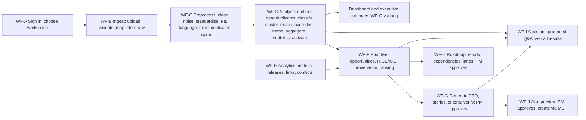
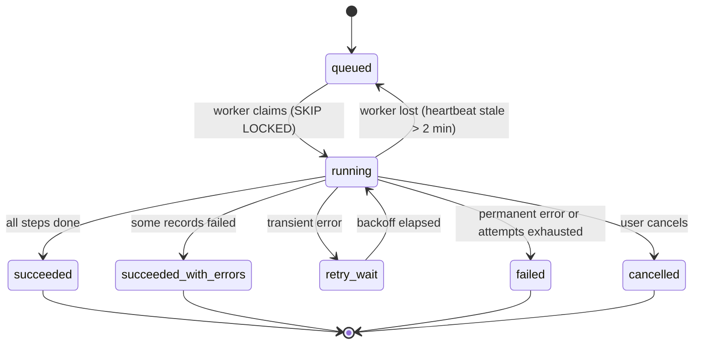
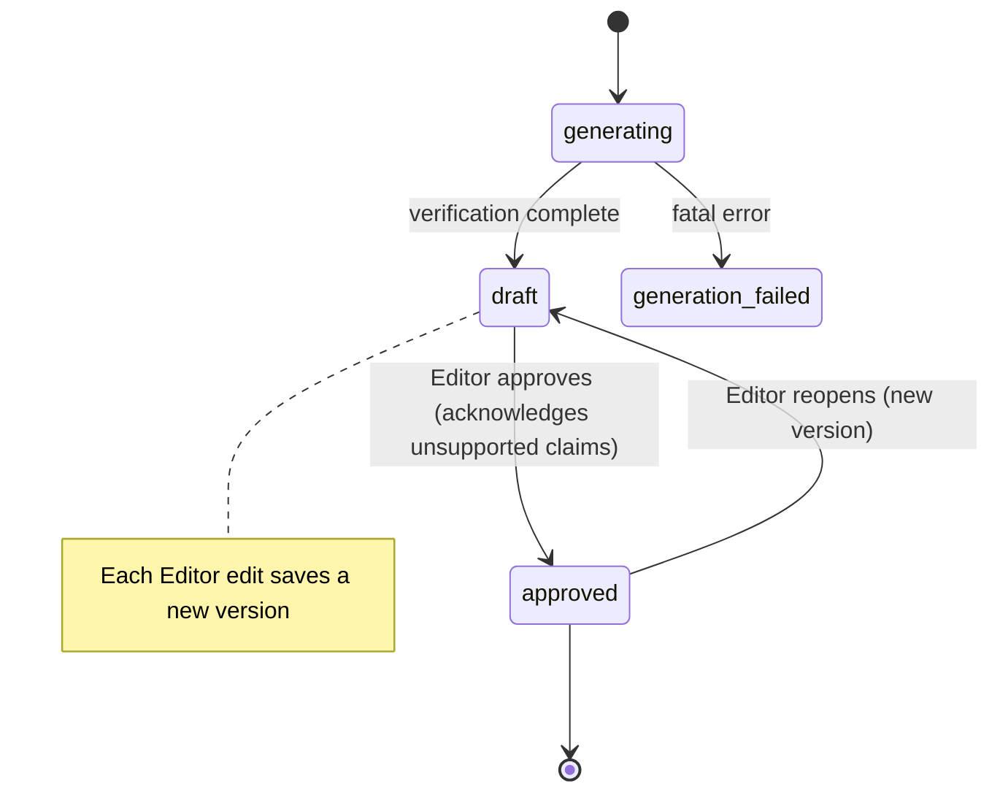
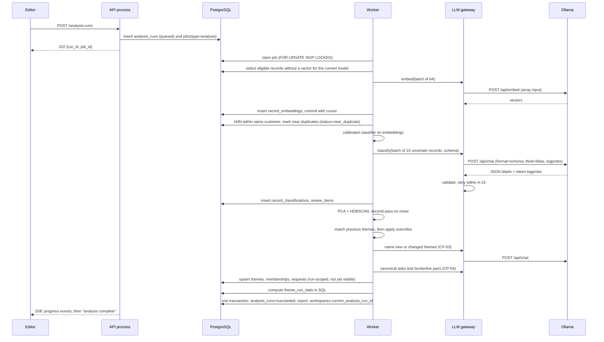
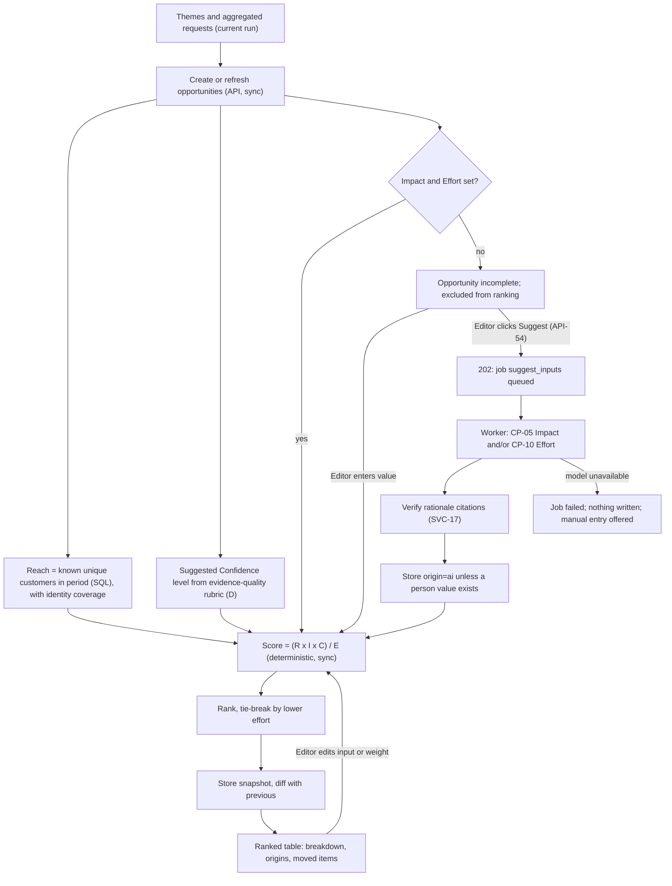
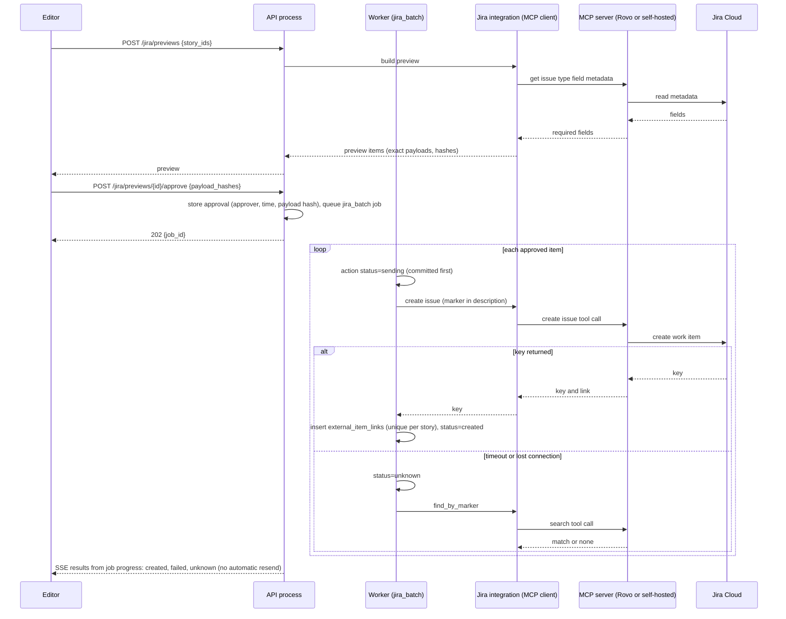

# 02 · End-to-End Workflows

Each workflow lists trigger, inputs, processing, services (doc 03), AI calls (doc 04 §3), database operations (doc 07), outputs, failures and human approval points. The canonical processing order is defined once in doc 06 §1; WF-B, WF-C and WF-D follow it.

**Execution model.** Synchronous work runs in the API request (reads, edits, deterministic scoring, approvals). Every model call except the assistant's runs in the worker as a job (ingest, analysis, document generation, score suggestions). The assistant runs in-request under a 5-minute deadline (doc 04 §5.2).

## 1. End-to-end view

## 2. Job and document state machines

## WF-A Authentication and workspace

| Field | Detail |
|---|---|
| Trigger | Visitor opens the app; user creates or switches workspace |
| Inputs | Email, password; workspace name, product profile; member email and role |
| Processing | 1. Register: validate email uniqueness, hash with Argon2id, create user. 2. Sign in: check throttle (A-08), verify hash, create session (random 256-bit token stored hashed), set HttpOnly SameSite=Lax cookie and CSRF token. 3. Create workspace: create workspace and Owner membership in one transaction. 4. Add member (Owner only): existing user, role default Viewer. 5. Every later request: load session, refresh idle expiry (A-07), resolve membership for the workspace in the path, check role, `SET LOCAL app.workspace_id` for row-level security |
| Services | SVC-01 |
| AI calls | None |
| Database | users, sessions, login_attempts, workspaces, workspace_memberships, audit_logs |
| Outputs | Session; workspace; membership |
| Failures | Wrong credentials: generic error and counted attempt. Non-member: 404 without data. Insufficient role: 403 naming the role. Expired session: 401 |
| Human approval | None |
| SRS | FR-AUTH-01 to FR-AUTH-12, SEC-01 to SEC-06, SEC-21 |

## WF-B Data ingestion

| Field | Detail |
|---|---|
| Trigger | Editor uploads a file (MVP) or runs a connector sync (extension) |
| Inputs | File; source type; column mapping (new or saved); or connector config |
| Processing | 1. Upload streamed to `data/uploads/<workspace>/<uuid>`; size cap 20 MB; SHA-256 computed; identical file in workspace triggers a warning (DR-10). 2. Sniff format (CSV dialect, JSON array, TXT); detect encoding. 3. Preview first 20 rows; Editor maps columns; mapping saved optionally. 4. Create `import_jobs` row (queued) and a `jobs` row (type `ingest`). 5. Worker streams rows through validation; valid rows become `feedback_records` with `raw_text` and `stage = captured`; invalid rows are `rejected` into `import_row_errors` and not stored. 6. The same job continues into WF-C; at the end it writes the reconciliation report (doc 06 §10.1) |
| Services | SVC-02, SVC-03, SVC-04 |
| AI calls | None |
| Database | source_files, column_mappings, import_jobs, jobs, import_row_errors, feedback_records |
| Outputs | Job ID (202 Accepted); live progress over SSE; import report (snapshot) at the end; status `completed`, `completed_with_errors` (some rows failed) or `failed` (job error or reconciliation mismatch) |
| Failures | Corrupt or oversized file: rejected before job creation. Bad rows: listed, others continue (DR-36). Worker crash: job returns to queue and resumes from the last committed batch (DR-39) |
| Human approval | None |
| SRS | FR-ING-01 to FR-ING-12, DR-01 to DR-10, DR-31, DR-40 |

## WF-C Data preprocessing

| Field | Detail |
|---|---|
| Trigger | Continuation of the ingest job, batch by batch (500 records per batch) |
| Inputs | Captured records |
| Processing | Per batch, in the canonical order (doc 06 §1): clean → noise detection → standardisation and customer key → PII masking → language detection → exact-duplicate check on `hash(processed_text)` within the same customer → spam rules, CP-01 for the uncertain band → `analysable = true`, `stage = prepared`. The stored exclusion reason is the first that applies in that order: `noise`, `pii_failed`, `non_english`, `duplicate`, `spam`, `spam_review` (doc 06 §3.1). No embedding happens here |
| Services | SVC-05, SVC-06, SVC-07 |
| AI calls | CP-01 only for borderline spam (rule score in the uncertain band) |
| Database | feedback_records (update), customers (upsert), import_row_errors, review_items (spam review) |
| Outputs | Prepared, masked records, each with one outcome; reconciliation counts |
| Failures | PII masking error: reason `pii_failed`, text hidden (fail closed). CP-01 failure: reason `spam_review`, review item, excluded from statistics until resolved (CR-19). Stage error: retried twice, then the record is `failed` (DR-38). None of these stop the batch (DR-36) |
| Human approval | Editor may reverse noise or spam flags later (DR-14) and resolves spam reviews |
| SRS | DR-11 to DR-16, DR-18 to DR-25, DR-27 to DR-30, DR-36 to DR-40 |

## WF-D AI analysis

| Field | Detail |
|---|---|
| Trigger | Editor clicks "Run analysis", or automatically after an import completes |
| Inputs | Analysable records; previous analysis run and overrides |
| Processing | 1. **Run creation**: `analysis_runs` row with configuration snapshot (model tags, prompt versions, thresholds); eligible set = analysable records. 2. **Embedding** of records without a vector for the current model (the only place embeddings are created). 3. **Near-duplicate detection** within the same customer (cosine ≥ 0.95). 4. **Classification cascade**: calibrated classifier, then batched CP-02; sarcasm candidates always checked by CP-02; low confidence → `review_items`. 5. **Theme clustering** (ADR-09) with small-theme second pass. 6. **Theme identity matching** against previous themes. 7. **Override application** (ADR-10). 8. **Theme naming** (CP-03) for new or changed, unlocked themes. 9. **Feature-request aggregation**: canonical asks (CP-04), grouping, borderline checks. 10. **SQL statistics** into `theme_run_stats`. 11. **Persist**: every step already committed its rows under this `analysis_run_id` with the cursor; they stay invisible to readers. 12. **Activate**: set `workspaces.current_analysis_run_id` to this run in the final transaction, only if all steps succeeded |
| Services | SVC-07 (near duplicates), SVC-08, SVC-09, SVC-10, SVC-11, SVC-12, SVC-21 |
| AI calls | CP-02, CP-03, CP-04 |
| Database | analysis_runs, record_embeddings, record_classifications, review_items, themes, theme_memberships, theme_overrides, aggregated_requests, request_memberships, llm_call_records |
| Outputs | Themes with evidence, statistics (known customers, unknown-identity records, coverage), vocal-customer flags, small themes; aggregated requests; review queue; run report (doc 06 §10.2) |
| Failures | Model unavailable: job `retry_wait`, then `failed`; the previous run stays current (AIR-22). Embedding failure: record `embedding_failed` for this run only. Invalid LLM output after retries: classifier result kept if any, else `unclassified` and queued for review. Failures are reported in the run report, never in an import report |
| Human approval | Editor reviews low-confidence items, renames, merges, splits, moves (stored as overrides) |
| SRS | FR-THM-01 to FR-THM-12, FR-AGG-01 to FR-AGG-07, AIR-01 to AIR-04, DR-17, DR-26 |

## WF-E Product analytics

| Field | Detail |
|---|---|
| Trigger | Editor uploads a metrics CSV; registers a release; links a metric to a theme |
| Inputs | Rows (metric name, date, value, optional dimension); release version and date; link |
| Processing | 1. Validate rows (DR-41); create metric definitions on first sight. 2. Overlap with existing observations: Editor chooses replace, keep or cancel. 3. Register releases. 4. Trend: weekly series per metric with release markers. 5. Conflict detection for each theme–metric link (doc 03 SVC-13). 6. Spike detection on theme weekly counts |
| Services | SVC-13 |
| AI calls | None |
| Database | metric_definitions, metric_observations, product_releases, theme_metric_links |
| Outputs | Trends, conflicts, spikes |
| Failures | Invalid rows listed; no analytics data gives an explicit "no behaviour data" state |
| Human approval | Editor accepts suggested links (FR-ANA-06) and interprets conflicts |
| SRS | FR-ANA-01 to FR-ANA-06, DR-41, FR-DSH-08 |

## WF-F Prioritisation

| Field | Detail |
|---|---|
| Trigger | Editor opens Opportunities, changes a framework, input or weight, or asks for AI suggestions |
| Inputs | Themes and aggregated requests of the current run; scoring configuration; Editor inputs |
| Processing | **Synchronous (API):** 1. Create or refresh opportunities from themes and requests (one per source, idempotent). 2. Fill data-derived inputs: Reach = known unique customers in the period, shown with identity coverage; suggested Confidence level from the evidence-quality rubric (doc 03 SVC-15). 3. Compute scores deterministically. 4. Rank; store a snapshot with configuration hash; diff with the previous snapshot; return moved items. **Asynchronous (worker):** 5. When the Editor asks for suggestions (API-54), a `suggest_inputs` job runs CP-05 (Impact) and/or CP-10 (Effort), verifies rationale citations, stores them with `origin = ai` unless a person-set value exists, then recomputes the ranking and emits a progress event |
| Services | SVC-15 |
| AI calls | CP-05, CP-10 |
| Database | opportunities, scoring_configs, score_inputs, score_snapshots, claims, jobs |
| Outputs | Ranked list with breakdown, origins, explanations, moved items |
| Failures | Missing inputs: opportunity "incomplete", excluded from ranking. Suggestion job: model unavailable → `retry_wait` then `failed`; no input is written; the opportunity stays incomplete and the UI offers manual entry |
| Human approval | Editor sets or overrides any input; records decisions |
| SRS | FR-PRI-01 to FR-PRI-11, AIR-08 |

## WF-G Document generation (PRD, stories, criteria; also executive summary)

| Field | Detail |
|---|---|
| Trigger | Editor selects an opportunity and clicks "Generate PRD" (or "Generate executive summary" on the dashboard) |
| Inputs | Opportunity; product profile; theme and request statistics; evidence |
| Processing | 1. Create `documents` row (status `generating`) and job `generate_document`. 2. Build evidence pack (doc 05). 3. Outline (CP-06 step 1). 4. One call per section, with typed claims and evidence IDs (CP-06 step 2). 5. Fill number placeholders from SQL. 6. Deterministic checks; regenerate failing sections once. 7. Support check (CP-07). 8. Stories and Given/When/Then criteria come from verified problem statements. 9. Save version 1, status `draft`. 10. Editor reviews, edits (new versions), approves with acknowledgements |
| Services | SVC-14, SVC-16, SVC-17 |
| AI calls | CP-06, CP-07 (CP-08 for the executive summary) |
| Database | documents, document_versions, claims, claim_evidence, verification_results, user_stories, acceptance_criteria, approvals |
| Outputs | Draft with per-claim statuses; approved document |
| Failures | Section failure: section marked failed, others kept. No evidence: generation refused with explanation |
| Human approval | **Required** for approval (FR-DOC-08, SEC-13) |
| SRS | FR-DOC-01 to FR-DOC-12, FR-DSH-03, AIR-13 to AIR-19 |

The detailed generation sequence is in doc 04 §7.

## WF-H Roadmap

| Field | Detail |
|---|---|
| Trigger | Editor opens Roadmap and selects opportunities (accepted or top-ranked) |
| Inputs | Scores, efforts, dependencies, lane capacity |
| Processing | 1. Read each opportunity's current Effort input (person, AI-labelled estimate or none); missing goes to "unscheduled". 2. Build dependency graph; reject cycles. 3. Topological order using score (ties: lower effort). 4. Fill Now, Next, Later by capacity (default 6 person-weeks each). 5. Editor moves items or sets a roadmap-specific effort; violations flagged. 6. Editor marks roadmap approved (stored as an approval). All steps are synchronous; an Effort suggestion is requested through API-54 and arrives asynchronously, after which the roadmap re-plans unscheduled items |
| Services | SVC-18 |
| AI calls | CP-10 through the `suggest_inputs` job (optional, asynchronous) |
| Database | roadmaps, roadmap_items, roadmap_dependencies, approvals |
| Outputs | Lanes with items linked to opportunities and evidence |
| Failures | Cycle: rejected with the cycle path shown |
| Human approval | Roadmap approval (recorded, not required by the SRS but recommended) |
| SRS | FR-RMP-01 to FR-RMP-07 |

## WF-I Conversational intelligence

| Field | Detail |
|---|---|
| Trigger | User submits a question in the assistant |
| Inputs | Question, conversation history (last 6 turns), workspace context |
| Processing | Bounded tool loop (doc 04 §5) under a strict 5-minute deadline from request start: the model selects read-only tools; the server validates and runs them with the session's workspace and role; quantitative facts come from SQL tools; qualitative evidence from hybrid retrieval; every model call, tool call and verification uses the remaining time; the final answer is verified (citations, numbers) before it is sent |
| Services | SVC-19, SVC-14, SVC-17 |
| AI calls | CP-09 |
| Database | chat_sessions, chat_messages, tool_call_records, llm_call_records |
| Outputs | Cited answer, tools used; or an insufficient-evidence answer |
| Failures | Tool error: reported as missing part. Deadline, turn or tool limit reached: only already-verified content is returned, marked incomplete (doc 04 §5.2). Model unavailable: clear message |
| Human approval | None (read-only) |
| SRS | FR-AST-01 to FR-AST-10, AGR-06 to AGR-11 |

## WF-J Jira integration

| Field | Detail |
|---|---|
| Trigger | Editor selects stories of an approved PRD and clicks "Send to Jira" |
| Inputs | Approved stories; integration configuration; target project |
| Processing | **Synchronous (API):** 1. Check integration health and story eligibility (approved, not already linked). 2. Map fields deterministically; strip PII; add PRD reference, evidence summary and marker `ai-pm-copilot:<story_id>`. 3. Fetch issue-type field metadata through MCP to validate required fields. 4. Show preview. 5. Editor approves, edits or rejects each item; approval stored with exact payload hash; a `jira_batch` job is queued. **Asynchronous (worker):** 6. For each approved item: set action `sending`, commit, call create through MCP. 7. On success store key and link (unique per story) and verify with a read. 8. On timeout or lost connection set `unknown`; a reconcile step searches for the marker before anything is retried. 9. Report successes, failures and unknowns |
| Services | SVC-20 |
| AI calls | None (the LLM never calls Jira, AGR-13) |
| Database | integration_configs, integration_actions, external_item_links, approvals, audit_logs |
| Outputs | Jira keys and links |
| Failures | Auth error: integration "needs attention", no retry. Timeout during create: `unknown`, reconciled by marker search (up to 3 searches over 2 minutes); if still not found, the Editor decides to retry or to link an existing key manually. Worker crash during `sending`: on restart the action is treated as `unknown`, never resent blindly. Rejected item: no call |
| Human approval | **Required**, per batch preview (AGR-19, AGR-20) |
| SRS | AGR-12 to AGR-25, FR-DOC-12 |

