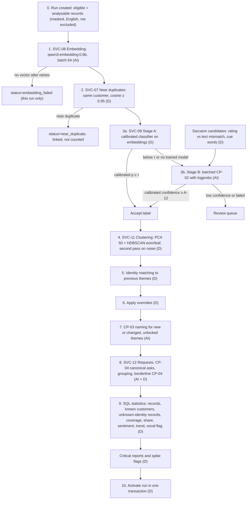

# 03 · Low-Level Design

Internal design of each service. **D** marks deterministic code; **AI** marks an LLM call (doc 04 §3) or embedding. The LLM never computes counts, unique customers, percentages, trends, scores, permissions or evidence-ID validity.

Conventions: every service function takes a `ctx` (user ID, workspace ID, role, correlation ID); repositories refuse queries without `ctx.workspace_id`; every log line carries the correlation ID; errors are raised as typed exceptions mapped to the API error envelope (doc 09 §2).

## AI analysis engine (overview)

Steps follow the canonical analysis order (doc 06 §1); numbers show the order.

## Services

### SVC-01 Authentication and Workspace Service

| Aspect | Design |
|---|---|
| Purpose | Identity, sessions, workspaces, membership, roles (CMP-02) |
| Functions | `register(email, password)`, `login(email, password, ip)`, `logout(session)`, `load_session(token)`, `create_workspace(ctx, name, profile)`, `add_member(ctx, email, role)`, `change_role`, `remove_member`, `require_role(ctx, min_role)` |
| Logic (D) | Argon2id hash (argon2-cffi defaults). Session token: 32 random bytes, URL-safe; only its SHA-256 stored. Idle expiry 30 minutes (A-07); absolute expiry 12 hours (design default). Throttle: count failed attempts for the email in the last 15 minutes; 5 or more blocks until the oldest of them is 15 minutes old (A-08). CSRF token: random per session, required in `X-CSRF-Token` on writes. Workspace creation inserts workspace and Owner membership in one transaction. New members default to Viewer (SEC-21) |
| Contracts | `login` → `{user, csrf_token}` and cookie; `require_role` raises `NotFound` for non-members (no data leak) and `Forbidden(required_role)` for insufficient role |
| Database | users, sessions, login_attempts, workspaces, workspace_memberships, audit_logs |
| Validation | Email format and uniqueness (case-insensitive); password 12 to 128 characters (doc 10 §2) |
| Errors | Generic "invalid email or password"; throttled → 429 with retry time |
| Logging | Sign-in success and failure, membership changes → audit_logs (SEC-14) |
| SRS | FR-AUTH-01 to FR-AUTH-11, SEC-01 to SEC-05, SEC-21 |

### SVC-02 Data Source Adapter Service

| Aspect | Design |
|---|---|
| Purpose | Turn any source into a stream of `RawItem` (CMP-04, doc 01 §3.2) |
| Functions | `get_adapter(kind)`, `FileAdapter.open(path, mapping)`, `FileAdapter.preview(path, n=20)`, `ConnectorAdapter.fetch(since)` |
| Logic (D) | Encoding detection (charset-normalizer); CSV dialect via `csv.Sniffer` on the first 64 KB; JSON must be an array of objects (DR-05); TXT transcripts split into speaker turns with the pattern `^\s*([A-Z][\w .'-]{0,40}):\s` and, if absent, into paragraphs (DR-27). Mapping applies column → standard field. Connector adapters page through vendor APIs, honour `Retry-After`, and checkpoint after each committed page |
| Contracts | `RawItem{row_number, source_record_id?, text, occurred_at_raw?, customer_ref?, rating_raw?, version_raw?, metadata{}}` |
| Database | data_sources (sync_state), column_mappings |
| Errors | Unknown format → `UnsupportedFile`; decoding errors → row error |
| SRS | FR-ING-01, FR-ING-03, FR-ING-11, DR-05, DR-27, CR-10 |

### SVC-03 Data Ingestion Service

| Aspect | Design |
|---|---|
| Purpose | Upload handling, job creation, raw storage, status, report (CMP-05) |
| Functions | `store_upload(ctx, stream, filename)`, `create_import(ctx, file_id, source_type, mapping)`, `run_ingest_step(job, cursor)`, `build_report(import_id)`, `retry_import`, `remove_import` |
| Logic (D) | Stream to `data/uploads/<workspace>/<uuid>`; reject over 20 MB; SHA-256; warn if the same hash exists in the workspace (DR-10). Ingest in batches of 500 rows: validate (SVC-04), insert `feedback_records` with `raw_text`, `stage='captured'`, unique key `(import_job_id, row_number, segment_index)` so a retry cannot duplicate (FR-ING-07). Continue into preprocessing in the canonical order (doc 06 §1). Report and reconciliation per doc 06 §10.1; the report is a snapshot at completion |
| Database | source_files, import_jobs, import_row_errors, feedback_records, jobs |
| Errors | Batch failure → job `retry_wait` (max 2) → failed records listed (DR-38) |
| Logging | Job events with counts; audit entry on import and removal |
| SRS | FR-ING-01 to FR-ING-12, DR-02 to DR-04, DR-31, DR-35 to DR-40 |

### SVC-04 Data Validation Service

| Aspect | Design |
|---|---|
| Purpose | File-level and row-level validation (CMP-06) |
| Rules (D) | File: extension matches sniffed content; ≤ 20 MB; decodable. Row: mapped text field present and non-empty after trim (DR-07); length ≤ 20,000 characters (longer is truncated for processing, original kept); timestamp parseable else `occurred_at = null` with flag (DR-08); rating numeric within detected scale; metrics: name, ISO date, numeric value (DR-41) |
| Output | `ValidRow` or `RowError{row_number, field, code, message}` |
| Database | import_row_errors |
| SRS | DR-05 to DR-09, DR-41 |

### SVC-05 Preprocessing and Cleaning Service

| Aspect | Design |
|---|---|
| Purpose | Clean, flag noise and spam, standardise (CMP-08); order in doc 06 §1 |
| Clean (D) | HTML unescape; strip tags; remove quoted reply blocks (lines starting `>`; "On … wrote:" and below); remove common signatures ("-- ", "Sent from my …"); remove control characters; Unicode NFC; collapse whitespace (DR-11, DR-19) |
| Noise (D) | Proposed rule (CR-02): noise if no alphabetic word remains, or text matches a boilerplate list ("test", "n/a", "ok", "."), or it has fewer than 3 words **and** contains no signal term (problem, product, feature or emotion lexicon such as "crash", "login", "slow", "refund", "love", "hate"). "app crashes" is kept |
| Spam (D + AI) | Last preprocessing stage. Score = weighted sum of: URL count, promotional phrases, repeated characters, all-caps ratio, the same text from 5 or more different customers within 24 hours. Score ≥ 0.8 → `spam`; 0.4–0.8 → CP-01; < 0.4 → `clean` (thresholds tuned on seeded data). If CP-01 fails after retries, the record is **not** assumed clean: `spam_status = review_required`, reason `spam_review`, review item, excluded from statistics until resolved (CR-19) |
| Standardise (D) | Timestamps → UTC (`python-dateutil`; date-only treated as 00:00 UTC) (DR-21). Rating: detect scale from the import's maximum (5, 10, 100) and map to 1–5 (A-24). Version: extract `\d+(\.\d+){0,3}` (DR-22). Customer key: HMAC-SHA256 of the normalised identifier with a per-workspace secret (DR-23). Records without an identifier get `customer_id = null` (**unknown identity**). They are never counted as customers: statistics report known unique customers, unknown-identity records and identity coverage separately (CR-18) |
| Database | feedback_records, customers |
| SRS | DR-11 to DR-15, DR-19 to DR-23 |

### SVC-06 PII Masking Service

| Aspect | Design |
|---|---|
| Purpose | Detect and mask personal information before any model or display use (CMP-09) |
| Logic (D) | Presidio AnalyzerEngine (Python 3.11 to 3.14 supported [V]) with a small spaCy English model, built-in recognisers for EMAIL_ADDRESS, PHONE_NUMBER, CREDIT_CARD and PERSON, plus custom pattern recognisers (Indian mobile numbers, government ID patterns such as PAN and Aadhaar formats, card numbers validated with the Luhn check). Score threshold 0.5. Anonymizer replaces each span with `[EMAIL]`, `[PHONE]`, `[CARD]`, `[ID]`, `[NAME]` |
| Order | After cleaning, noise detection and standardisation; before language detection, exact-duplicate hashing, spam checks, embedding, display and any model call (DR-29). Runs on every stored record, including records already flagged as noise, because `processed_text` is the display layer |
| Contracts | `mask(text) -> {masked_text, entities: {type: count}}` |
| Database | `feedback_records.processed_text`, `pii_counts` |
| Errors | Fail closed: if masking raises, the record is not analysable (`exclusion_reason='pii_failed'`) |
| Validation | Seeded PII set measures recall (TST-14) |
| SRS | DR-28 to DR-30, NFR-21 |

### SVC-07 Duplicate Detection Service

| Aspect | Design |
|---|---|
| Purpose | Exact and near duplicates without hiding genuine corroboration (CMP-08) |
| Key rule | Two **different customers** writing the same complaint is corroboration, not duplication. Duplicates are therefore scoped to the same customer, or to records with no customer identifier from the same source within 24 hours. Identical text from many different customers is a spam signal (SVC-05), not a duplicate. This clarifies DR-16 and DR-17 (CR-16) |
| Exact (D, ingestion) | Runs after PII masking and language detection. `content_hash = sha256(casefold(processed_text with punctuation and whitespace removed))`, always from masked text. Duplicate if an earlier record has the same hash and the same customer key (or both unknown, same source, within 24 hours) → `exclusion_reason = 'duplicate'`, `duplicate_of` |
| Near (D, analysis step 2) | After embedding in the analysis run: nearest neighbours (k=5) among the same customer's earlier records; cosine ≥ 0.95 (A-10 starting value) → `record_classifications.status = 'near_duplicate'`, `near_duplicate_of` set for that run. The import report is not changed |
| Output | Exact: `duplicate_of`; near: `near_duplicate_of` per run. Neither is counted as an extra record or customer (DR-18) |
| Database | feedback_records, record_embeddings |
| SRS | DR-16 to DR-18 |

### SVC-08 Embedding Service

| Aspect | Design |
|---|---|
| Purpose | Vectors for retrieval, clustering, near duplicates, request grouping (CMP-11). Called only by the analysis job (step 1) and for query embedding by retrieval; never by ingestion |
| Logic (AI, via gateway) | `POST /api/embed` with an array input [V], batch size 64 (tuned in EXP-04), `qwen3-embedding:0.6b`; vectors L2-normalised; stored with `model_id` and dimension. Queries for retrieval use the model's query instruction format; documents are embedded as plain masked text (model-card convention [3P], checked in EXP-04) |
| Contracts | `embed_records(ctx, record_ids)`, `embed_query(text)`, `embed_texts(texts)` |
| Database | record_embeddings |
| Errors | Batch failure retried twice; then each record of the batch is embedded alone; still failing → `record_classifications.status = 'embedding_failed'` for this run (doc 06 §10.2) |
| SRS | DR-26, AIR-21 |

### SVC-09 Classification Service

| Aspect | Design |
|---|---|
| Purpose | Category (FR-THM-01), sentiment (FR-THM-02), sarcasm flag (FR-THM-10), calibrated confidence (AIR-02, A-12) |
| Stage A (D) | When a labelled training split exists: multinomial logistic regression on embeddings, wrapped in `CalibratedClassifierCV` (cross-validated calibration). Accept if calibrated probability ≥ τ, where τ is chosen on validation data so that accepted labels reach the target precision. Separate models for category and sentiment |
| Stage B (AI) | CP-02 on the remaining records, batches of 10 with stable record keys; JSON schema output; `think=false`; temperature 0; `logprobs=true` [V]. Confidence = probability of the chosen label's first token, calibrated with Platt scaling on validation data (CR-04) |
| Sarcasm (D + AI) | Candidates: rating ≤ 2 with positive words, or rating ≥ 4 with negative words; ironic cues ("yeah right", "thanks for nothing", quotation marks around praise). Candidates always go through CP-02 with the sarcasm field; flagged records are excluded from sentiment statistics until reviewed |
| Labels | `category` ∈ {`bug_report`, `feature_request`, `usability_issue`, `performance_issue`, `praise`, `question`, `other`} (FR-THM-01); `sentiment` ∈ {`positive`, `neutral`, `negative`, `mixed`} (FR-THM-02); no separate intent field (intent is expressed by the category, G-13) |
| Routing | Calibrated confidence < A-12 threshold → `review_items`; row stored with `status='classified'`, `method='classifier' | 'llm'`; if both stages fail, `status='unclassified'` and a review item |
| Cold start | No labels yet: Stage A disabled; Stage B only |
| Database | record_classifications (per analysis run), review_items |
| SRS | FR-THM-01, FR-THM-02, FR-THM-08, FR-THM-10, AIR-01, AIR-02, AIR-23 |

### SVC-10 Theme Extraction Service

| Aspect | Design |
|---|---|
| Purpose | Coordinates an analysis run in the canonical order (doc 06 §1): eligibility, embedding, near duplicates, classification, clustering, identity, overrides, naming, requests, statistics, activation (CMP-14) |
| Steps | 0. Create `analysis_runs` with config snapshot; eligible = analysable (English, not excluded, A-03). 1. SVC-08 embedding. 2. SVC-07 near duplicates. 3. SVC-09 classification. 4. SVC-11 clustering. 5. Identity matching. 6. Overrides. 7. CP-03 naming for new or materially changed themes (membership Jaccard < 0.8 with the previous version) that are not name-locked. 8. SVC-12 request aggregation. 9. Statistics (SQL). 10. Vocal-customer flag: theme ≥ 10 records with known identity and top customer share > 20% of those (A-11); if identity coverage is below 50% the flag is shown as "not assessable". 11. Critical reports (CR-03): records with category `bug_report` or `performance_issue`, negative sentiment and a severity term (crash, data loss, charged twice, cannot log in, security, privacy, hacked) are listed even when they belong to no theme or to a small theme. 12. Activate: run status, report and `workspaces.current_analysis_run_id` in one transaction |
| Statistics (D, SQL) | record_count; `known_customers` = distinct non-null customer IDs; `unknown_identity_records` = records with no customer ID; `identity_coverage` = records with a customer ID ÷ record_count; share = record_count / classified records in the run; sentiment distribution excluding sarcasm-flagged records; weekly counts; trend direction (slope of the last 8 weeks). Near duplicates, embedding failures and unclassified records are excluded |
| Database | analysis_runs, themes, theme_memberships, theme_overrides |
| SRS | FR-THM-03 to FR-THM-07, FR-THM-09, FR-THM-12, AIR-03, AIR-04 |

### SVC-11 Clustering Service

| Aspect | Design |
|---|---|
| Purpose | Group eligible records into themes reproducibly (AIR-04) |
| Algorithm (D) | L2-normalised embeddings → PCA to 50 components (`random_state=42`) → scikit-learn `HDBSCAN` (added in 1.3; current docs 1.9.1 [V]). Candidate settings: `min_cluster_size` in {5, 10, 15, max(5, n/200)}, `cluster_selection_method` in {`eom`, `leaf`} [V]. EXP-06 picks the setting with the best adjusted Rand index against labelled groups, subject to coverage of at least 70% (team proposal) |
| Small themes | Second HDBSCAN pass on first-pass noise with `min_cluster_size=3` → themes marked `size_class='small'`. Remaining noise is the visible unassigned group (FR-THM-07) |
| Identity across runs (D) | For each new cluster, the previous theme with the highest membership Jaccard over records present in both runs; accept if ≥ 0.5, else centroid cosine ≥ 0.85; otherwise a new theme. Matched themes keep ID, name and locks (ADR-10) |
| Overrides (D) | Applied after matching, in order: record pins (record → theme), exclusions, merges (A into B), splits (Editor-defined groups), renames (name locked). Overridden themes are not renamed by CP-03 |
| Merge suggestions | Pairs of themes whose centroids have cosine > 0.9 are suggested to the Editor, never merged automatically |
| Database | themes (centroid stored as vector), theme_memberships (with `source='cluster' | 'override'`), theme_overrides |
| SRS | FR-THM-03, FR-THM-07, FR-THM-09, FR-THM-11, FR-THM-12, AIR-04 |

### SVC-12 Feature Request Aggregation Service

| Aspect | Design |
|---|---|
| Purpose | Group equivalent asks and count them (CMP-15) |
| Candidates (D) | Category feature request, plus records with request cues ("please add", "would be great if", "I wish", "can you add") |
| Logic | CP-04 extracts a canonical ask, ≤ 12 words, in batches of 10 (AI). Ask embeddings (AI). Agglomerative clustering, cosine distance, average linkage, `distance_threshold=0.25` (tuned on labelled pairs) (D). Pairs with distance 0.20–0.30 across clusters go to CP-04 for a same/different decision (AI); "different" with high confidence splits, uncertain pairs are flagged (FR-AGG-06). Title = the ask closest to the group centroid (D) |
| Counts (D, SQL) | request_count = records; known unique customers = distinct non-null customer IDs; unknown-identity records and coverage shown beside them (FR-AGG-04, CR-18); weekly volume (FR-AGG-07) |
| Database | aggregated_requests, request_memberships |
| SRS | FR-AGG-01 to FR-AGG-07 |

### SVC-13 Product Analytics Service

| Aspect | Design |
|---|---|
| Purpose | Metrics, releases, links, trends, conflicts, spikes (CMP-16) |
| Trend (D) | Weekly aggregation (sum or average per metric definition); slope via least-squares over the last 8 weeks; direction up, flat or down using a minimum relative change of 5% (team proposal) |
| Conflict (D) | Each link stores an expected relation (`positive` or `negative`). Conflict if theme demand rises (or is in the top quartile of known customers) while the linked metric moves against the expected relation, or the feature's usage share is below 5% while its request group is in the top quartile. Both values are shown; the system never chooses (FR-ANA-05) |
| Spike detection (D) | Weekly theme count above the prior 8-week mean plus 3 standard deviations and at least 5 records → "emerging" flag (CR-06) |
| Database | metric_definitions, metric_observations, product_releases, theme_metric_links |
| SRS | FR-ANA-01 to FR-ANA-06, DR-41, FR-DSH-08 |

### SVC-14 Evidence and Retrieval Service

| Aspect | Design |
|---|---|
| Purpose | Find and package evidence; resolve citations (CMP-17); full design in doc 05 |
| Functions | `hybrid_search(ctx, query, filters, k)`, `build_evidence_pack(ctx, purpose, scope, token_budget)`, `resolve(ctx, evidence_ids)` |
| Logic (D) | Vector top 50 + full-text top 50 → Reciprocal Rank Fusion (k=60) → maximal marginal relevance (λ=0.7) → at most 2 records per customer (A-14) → token budget. Each item carries its evidence ID `E-<short id>` |
| Database | feedback_records, record_embeddings, theme_memberships |
| SRS | AIR-05 to AIR-07, AGR-10, NFR-17 |

### SVC-15 Prioritisation Service

| Aspect | Design |
|---|---|
| Purpose | Opportunities, scoring, provenance, ranking, explanations (CMP-18) |
| Formulas (D) | RICE = (Reach × Impact × Confidence) ÷ Effort [V S-42]; ICE = Impact × Confidence × Ease (1 to 10 each) |
| Reach (D) | Known unique customers linked to the opportunity in the scoring period (or a linked metric's user count, or a person-entered value). Unknown-identity records are **not** added; identity coverage is shown beside Reach, and low coverage lowers the suggested Confidence (CR-18) |
| Impact | Standard RICE scale {3, 2, 1, 0.5, 0.25} [V S-42]; set by a person or suggested by CP-05 |
| Confidence | Standard RICE levels: 100% high, 80% medium, 50% low [V S-42]. **Project-specific adaptation:** a rubric suggests the level (origin `data`) and always shows its reasons; a person can set any level (origin `person`). Start at high and lower one level for each factor present, floor at low: (1) fewer than 5 supporting records, or the source theme is `small` (evidence sufficiency); (2) identity coverage below 50% (Reach uncertain); (3) more than 30% of the supporting labels low-confidence or uncalibrated (label uncertainty); (4) a feedback-versus-behaviour conflict (FR-PRI-10); (5) Impact or Effort is an AI suggestion not yet confirmed by a person (assumption risk). Customer counts do not set Confidence; Reach and Confidence stay separate (ADR-18) |
| Effort | Person-weeks (> 0). Standard RICE uses person-months [V S-42]; weeks are a **project adaptation** to match the roadmap capacity unit. Shared by RICE and the roadmap; set by a person or suggested by CP-10 (labelled estimate) |
| Provenance (D) | Each input change inserts a new `score_inputs` row (value, origin `data` / `ai` / `person`, rationale, evidence IDs, set_by, created_at) and marks the previous row not current; nothing is overwritten, so the full override history is kept. A person-set value is never replaced by data or AI; a later AI suggestion is stored as not current and shown as "suggestion available" |
| AI suggestions | Asynchronous only: API-54 queues a `suggest_inputs` job; the worker runs CP-05 and/or CP-10, verifies citations (SVC-17), writes the inputs and recomputes the ranking. Failures leave the input empty |
| Explanation (D) | For A above B: per-input ratio A/B ordered by contribution to the log-score difference |
| Ranking (D) | Synchronous. Sort by score; tie-break lower effort, then older opportunity; snapshot with configuration hash; diff → moved items; incomplete opportunities excluded |
| Database | opportunities, scoring_configs, score_inputs, score_snapshots, claims (AI rationales), jobs |
| SRS | FR-PRI-01 to FR-PRI-11, AIR-08 |

### SVC-16 PRD Generation Service

| Aspect | Design |
|---|---|
| Purpose | Draft PRDs, stories and criteria; executive summaries (CMP-19) |
| Steps | Job `generate_document`: (1) evidence pack; (2) CP-06 outline; (3) CP-06 per section with typed claims; (4) placeholder filling (D); (5) SVC-17 checks; one regeneration for failing sections; (6) CP-07 support check; (7) stories and criteria from verified problem statements; (8) save version 1 as `draft` |
| Template | Sections: problem, evidence, goals, scope, user stories, acceptance criteria, success metrics, risks, open questions (FR-DOC-02) |
| Placeholders (D) | `{{theme:<id>.known_customers}}`, `{{theme:<id>.unknown_identity_records}}`, `{{theme:<id>.record_count}}`, `{{theme:<id>.share_pct}}`, `{{theme:<id>.trend_direction}}`, `{{metric:<id>.latest}}`; unknown placeholders fail the section |
| Database | documents, document_versions, claims, claim_evidence, user_stories, acceptance_criteria |
| SRS | FR-DOC-01 to FR-DOC-12, FR-DSH-03 |

### SVC-17 Verification Service

| Aspect | Design |
|---|---|
| Purpose | Check every claim; assign statuses (CMP-20) |
| Checks (D) | (1) Each evidence ID exists in the workspace and was in the pack supplied to that call (AIR-14). (2) Quotations are exact substrings of the cited record's processed text (AIR-15). (3) Prose contains no digits outside placeholders, except allow-listed literals in acceptance criteria (AIR-16). (4) A qualitative claim about "users" cites at least 3 distinct known customers (A-13), unless it is phrased as an individual report and cites a critical report (CR-03). Records with unknown identity never count as distinct customers; as proposed in CR-18, 3 or more of them may support only the wording "N separate reports (customer identity unknown)". (5) Recommendations are typed and shown separately (AIR-18) |
| Support (AI) | CP-07 using a different model or prompt from the generator; result supported, partly supported, unsupported, or not checked (AIR-17) |
| Database | claims, verification_results |
| SRS | AIR-13 to AIR-18, SEC-13, NFR-26, NFR-27 |

### SVC-18 Roadmap Service

| Aspect | Design |
|---|---|
| Purpose | Lanes, dependencies, edits (CMP-26) |
| Algorithm (D) | Kahn's topological sort with a priority queue keyed by (−score, effort); a cycle raises `DependencyCycle(path)`. Lanes filled in order: Now until cumulative effort ≥ capacity (6 person-weeks default, FR-RMP-07), then Next, then Later. Items without effort → unscheduled. Editor moves are stored as position overrides; violations flagged (FR-RMP-04) |
| Effort source | The opportunity's current Effort input (SVC-15); a roadmap-specific person override is stored in `roadmap_items.effort_weeks`. An Effort suggestion is requested through API-54 (CP-10, asynchronous) |
| Database | roadmaps, roadmap_items, roadmap_dependencies |
| SRS | FR-RMP-01 to FR-RMP-07 |

### SVC-19 Conversational Assistant

| Aspect | Design |
|---|---|
| Purpose | Grounded Q&A over workspace data (CMP-21); loop design in doc 04 §5 |
| Functions | `ask(ctx, session_id, question) -> stream` |
| Logic | Bounded loop: strict 5-minute deadline from request start (A-16); ≤ 4 model turns; ≤ 6 tool calls (A-16); every model call, tool call and verification gets `min(its cap, remaining time − 15 s reserve)`; duplicate-call detection; read-only tools only; final answer verified (SVC-17 checks 1 to 3); on expiry only verified content is returned, marked incomplete (doc 04 §5.2) |
| Database | chat_sessions, chat_messages, tool_call_records |
| SRS | FR-AST-01 to FR-AST-10, AGR-06 to AGR-11 |

### SVC-20 Jira MCP Integration

| Aspect | Design |
|---|---|
| Purpose | Approved stories → Jira issues through MCP (CMP-23) |
| Port | `JiraPort`: `health()`, `list_projects()`, `issue_type_fields(project, type)`, `create_issue(payload) -> {key, url}`, `get_issue(key)`, `find_by_marker(marker)`. Adapters: `RovoMcpAdapter` (remote `https://mcp.atlassian.com/v2/mcp` [V]) and `SelfHostedMcpAdapter` (community server over stdio or HTTP). Both use the official MCP Python SDK client |
| Allow-list (D) | The client calls only the mapped tools (metadata, create, get, search); any other tool name is refused locally (AGR-15) |
| Mapping (D) | Type Story if available else Task; summary ≤ 255 characters; description = story, acceptance criteria, PRD reference, evidence summary (counts and evidence IDs), and a marker `ai-pm-copilot:<story_id>`; label `ai-pm-copilot`; PII re-checked |
| Idempotency (D) | Exactly-once creation cannot be guaranteed over a remote call, so the design prevents duplicates instead: the action is set to `sending` and committed before the call; `external_item_links` is unique per story; a timeout, lost connection or worker crash during `sending` leads to `unknown`, and `find_by_marker` (up to 3 searches over 2 minutes, because search indexing can lag) decides before any resend; if still not found, the Editor chooses retry or manual link (AGR-23, AGR-24) |
| Credentials | Encrypted with Fernet (key from environment); never logged or sent to models (AGR-16) |
| Database | integration_configs, integration_actions, external_item_links, approvals |
| SRS | AGR-12 to AGR-25 |

### SVC-21 Workflow Orchestration Engine

| Aspect | Design |
|---|---|
| Purpose | Durable jobs for ingest, analysis, document generation, score suggestions, source sync, re-embedding, Jira batch, deletes, evaluation (CMP-10, CMP-22) |
| Claim (D) | `SELECT … FROM jobs WHERE status IN ('queued','retry_wait') AND run_after <= now() ORDER BY priority, created_at FOR UPDATE SKIP LOCKED LIMIT 1` |
| Steps | Each job type is an ordered list of step functions; `cursor` (JSON) records the step and batch position; each step commits its writes and the new cursor in one transaction |
| Heartbeat | Worker updates `heartbeat_at` every 15 seconds; jobs with a stale heartbeat (> 2 minutes) return to `queued` |
| Retry | Transient errors: exponential backoff 10 s, 40 s; max 2 retries per step (DR-38, A-15). Permanent errors: job `failed` with reason |
| Guarantees | Jobs are **restartable**, not exactly-once: a step may run again after a crash. Correctness comes from (1) idempotent steps (inserts keyed by unique constraints such as (import, row, segment), (run, record), (document, version), (story, system)); (2) checkpoint persistence: step results and the new `cursor` committed in one transaction; (3) idempotency keys on job creation (`jobs.idempotency_key`); (4) LLM responses cached by input hash, so a repeated step reuses completed calls; (5) reconciliation of uncertain external outcomes (Jira) before any resend |
| Limits | Per job-type timeout: ingest 60 minutes, analysis 120 minutes, document generation 15 minutes (CR-14), score suggestions 10 minutes, Jira batch 5 minutes |
| Concurrency | One worker process, one job at a time (matches `OLLAMA_NUM_PARALLEL=1`) |
| Database | jobs |
| SRS | AGR-01 to AGR-05, DR-36 to DR-39, NFR-10 |

### SVC-22 Audit and Evaluation Service

| Aspect | Design |
|---|---|
| Audit (D) | `audit(ctx, action, target_type, target_id, outcome, details)`; written in the same transaction as the action; insert-only table for the application role (SEC-15) |
| Evaluation (D) | Datasets imported as labelled CSV (CR-08); split into `train`, `validation`, `test` once and frozen; prompts may only use `train` examples. Runners compute macro-F1, adjusted Rand index, pairwise precision and recall, recall@10, nDCG@10, citation validity, numeric accuracy, rank correlation; results stored with model tags, prompt versions and config hash (AIR-20, NFR-30) |
| Model-call reporting | Aggregates from llm_call_records: calls, tokens, latency percentiles, failures (NFR-25) |
| Database | audit_logs, evaluation_datasets, evaluation_items, evaluation_runs, llm_call_records |
| SRS | SEC-14 to SEC-16, AIR-20, AIR-24, NFR-25, NFR-28 to NFR-30 |

### SVC-23 Reporting and Dashboard Service

| Aspect | Design |
|---|---|
| Purpose | Dashboard aggregates, drill-down, freshness, exports (CMP-27); customer figures show known unique customers with unknown-identity records and coverage (CR-18) |
| Logic (D) | Reads the current analysis run's statistics; every figure carries a drill-down query descriptor (filters) that returns exactly the counted records (AC-DSH-01); freshness from latest import and analysis timestamps; Markdown export with CSV formula neutralisation where tables are exported (SEC-12) |
| Database | Read-only over analysis, analytics and prioritisation tables |
| SRS | FR-DSH-01 to FR-DSH-09 |
