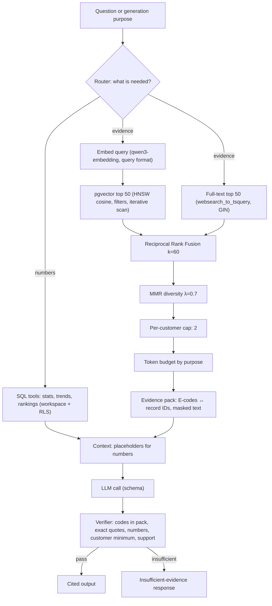
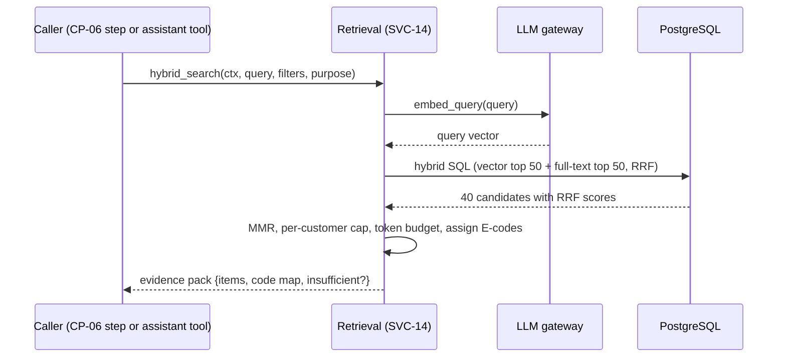

# 05 · Retrieval and Evidence Design

## 1. Principle

| Question type | Answered by | Never by |
|---|---|---|
| Quantitative: counts, known customers, unknown-identity records, shares, trends, rankings, scores | SQL through deterministic services and read-only tools | Retrieval or the language model |
| Qualitative: what customers say, examples, wording, reasons | Retrieved evidence with IDs, cited in the answer | Unsupported model knowledge |

## 2. Approaches considered

| Technique | Finding | Decision |
|---|---|---|
| Traditional RAG (vector search only) | Captures paraphrase; misses exact product terms, error codes, version strings | Not alone |
| Keyword search (PostgreSQL full-text) | Precise for names and codes; misses paraphrase | Combined |
| Hybrid with Reciprocal Rank Fusion | pgvector's README recommends combining vector and full-text search, using Reciprocal Rank Fusion or a cross-encoder [V] | **Selected** |
| Metadata filtering | Workspace, period, release, source, theme, sentiment are structured columns; filtering in SQL is exact. pgvector iterative index scans keep filtered recall [V] | **Selected** (always on for workspace) |
| Cross-encoder reranking | Usually improves precision, but needs another model runtime. No reranking endpoint was identified in the Ollama documentation consulted (EXP-05 verifies) | Not in MVP; experiment if precision@5 is weak |
| LLM reranking | Possible with `qwen3:4b`, but adds a model call per query on a single GPU | Rejected for MVP |
| Query rewriting / HyDE | The assistant already turns questions into structured tool arguments (period, theme, sentiment); free-text rewriting adds latency and drift | Rejected; structured arguments instead |
| Chunking | Feedback records are short and are natural units; long transcripts are not | Records unchunked; transcripts by speaker turn, ≤ 300 tokens, no overlap |
| Diversity (maximal marginal relevance) | Prevents near-identical evidence crowding the context | **Selected** (λ = 0.7) |

## 3. What is embedded, when, with which model

| Content | Embedded? | When | Notes |
|---|---|---|---|
| Feedback record processed (masked) text | Yes | Analysis run, step 1 (SVC-08); the only place record vectors are created | Only analysable records; excluded records are never embedded. Records imported after the last run have no vector yet and are found by full-text search only until the next run |
| Transcript segments | Yes | Analysis run, step 1 | Linked to the parent transcript (DR-27) |
| Canonical feature-request asks | Yes | Analysis (SVC-12) | Used only for grouping |
| Theme centroids | Computed (mean of member vectors) | Analysis | Used for identity matching and merge suggestions |
| Generated documents | No | n/a | Accessed by ID through `get_document` |
| Metrics | No | n/a | Numeric; SQL only |

**Model.** `qwen3-embedding:0.6b` through Ollama `/api/embed` with array input [V] (639 MB, 32K context [V]). Challengers: `bge-m3`, `nomic-embed-text`, `qwen3-embedding:4b` (2.5 GB [V]), compared in EXP-04 on duplicate detection, theme agreement and retrieval. Changing the model creates a `reembed` job; vectors are stored per `model_id`, so old and new can coexist during migration.

## 4. Storage and indexes

- `record_embeddings(workspace_id, record_id, model_id, embedding vector(<dim>))`; dimension read from the model at setup.
- HNSW index with the cosine operator class, partial per `model_id`.
- At 5,000 records per workspace an exact filtered scan may be fast enough; EXP-05 compares exact scan, HNSW with `hnsw.iterative_scan = relaxed_order`, and recall.
- Full-text: `feedback_records.search_tsv` generated from `processed_text` using the `english` configuration (A-03 analyses English only), with a GIN index.

## 5. Hybrid retrieval

```sql
-- inputs: :ws, :model, :qvec, :qtext, optional :from, :to, :theme
SET LOCAL hnsw.iterative_scan = relaxed_order;
WITH vec AS (
  SELECT r.id, row_number() OVER (ORDER BY e.embedding <=> :qvec) AS rk
  FROM feedback_records r
  JOIN record_embeddings e ON e.workspace_id = r.workspace_id AND e.record_id = r.id AND e.model_id = :model
  WHERE r.workspace_id = :ws AND r.analysable
    AND (:from IS NULL OR r.occurred_at >= :from) AND (:to IS NULL OR r.occurred_at < :to)
  ORDER BY e.embedding <=> :qvec LIMIT 50
), txt AS (
  SELECT r.id, row_number() OVER (ORDER BY ts_rank_cd(r.search_tsv, q) DESC) AS rk
  FROM feedback_records r, websearch_to_tsquery('english', :qtext) q
  WHERE r.workspace_id = :ws AND r.analysable AND r.search_tsv @@ q
    AND (:from IS NULL OR r.occurred_at >= :from) AND (:to IS NULL OR r.occurred_at < :to)
  ORDER BY ts_rank_cd(r.search_tsv, q) DESC LIMIT 50
)
SELECT id, SUM(1.0 / (60 + rk)) AS rrf
FROM (SELECT * FROM vec UNION ALL SELECT * FROM txt) u
GROUP BY id ORDER BY rrf DESC LIMIT 40;
```

Then, in Python (SVC-14):

1. Load candidates with customer key, date, theme IDs and vectors.
2. Maximal marginal relevance: select greedily by λ·relevance − (1−λ)·max similarity to already selected, λ = 0.7.
3. Per-customer cap: at most 2 records per customer key (A-14). Records with no customer key count individually.
4. Token budget: add items until the purpose's budget is reached (§6).
5. Assign short evidence codes `E1…En` for the prompt, mapped to record UUIDs in the pack.

Theme-scoped retrieval (PRD evidence) adds `AND r.id IN (SELECT record_id FROM theme_memberships WHERE theme_id = :theme AND run_id = :current_run)`.

## 6. Context assembly and evidence IDs

| Purpose | Evidence budget | Ordering |
|---|---|---|
| CP-05 Impact rationale | 1,500 tokens | Relevance after MMR |
| CP-06 PRD section | 4,500 tokens | Relevance after MMR; most recent first among ties |
| CP-08 Executive summary | 5,000 tokens across items | By theme rank, 2 to 3 records per theme |
| CP-09 Assistant | Tool results only, up to 10 records per `search_feedback` call | Tool order |

Each evidence item is rendered as:

```text
<customer_feedback id="E7" date="2026-10-02" source="review">
Checkout keeps spinning after I tap Pay. [NAME] said the same happened to her.
</customer_feedback>
```

Delimiter-like strings inside the text are escaped before rendering. The pack keeps `{E7 → record UUID}`; the model only ever sees short codes, and the verifier maps them back.

## 7. Citation validation

| Check | Rule | Result if failed |
|---|---|---|
| Existence and scope | Every cited code maps to a record in this pack, and therefore this workspace (AIR-14) | Claim unsupported; regenerate once |
| Quotation | Any quoted span is an exact substring of the cited record's processed text (AIR-15) | Claim unsupported |
| Numbers | No digits in prose except placeholders; placeholder values come from SQL (AIR-16) | Section regenerated once, then failed |
| Customer minimum | Claims about "users" cite at least 3 distinct known customers (A-13), unless phrased as an individual report of a critical issue (CR-03) or, if CR-18 is accepted, as separate reports with unknown identity | Claim downgraded to "individual report" wording or unsupported |
| Support | CP-07 advisory status (AIR-17) | Shown on the claim; approval needs acknowledgement if unsupported |

## 8. Insufficient evidence

The system answers "insufficient evidence" (FR-AST-05, FR-DOC-09) when any of these holds:
- Retrieval returns fewer than 3 records with RRF score above the calibrated floor (set in EXP-05).
- The relevant records come from fewer than 3 distinct known customers for a claim about users (A-13); unknown-identity records do not count (CR-18).
- The required numbers are not available from SQL (for example, no analytics data for a behaviour question).

The answer states what is missing and what the user can do (import data, register a release, run analysis).

## 9. Retrieval architecture





## 10. Retrieval evaluation

| Metric | Calculation | Data |
|---|---|---|
| Recall@10 | Relevant records retrieved in the top 10 ÷ all relevant records, averaged over questions | 30 labelled questions with relevant record sets |
| nDCG@10 | Discounted cumulative gain with graded relevance (2, 1, 0), normalised | Same |
| Precision@5 | Relevant in the top 5 ÷ 5 | Same |
| Customer diversity | Distinct customers ÷ items in the pack | Generated packs |
| Cap compliance | Packs with more than 2 items for any customer | Must be 0 |
| Workspace leakage | Items from another workspace | Must be 0 (TST-12) |

Compared configurations (EXP-05): vector only, full-text only, hybrid RRF, hybrid + MMR, and exact scan versus HNSW.
