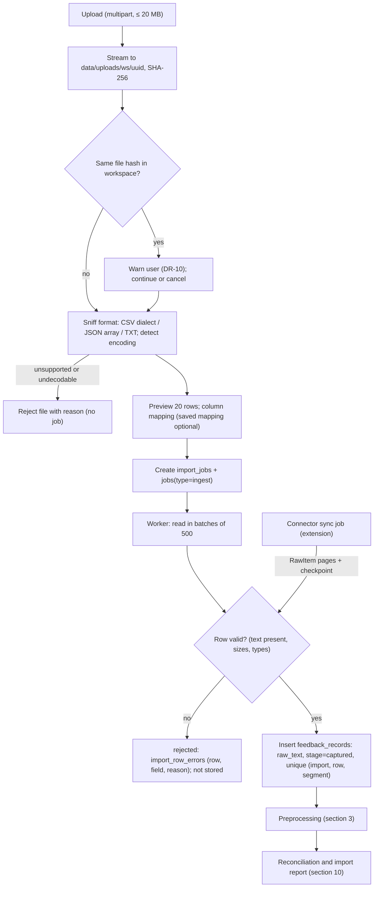
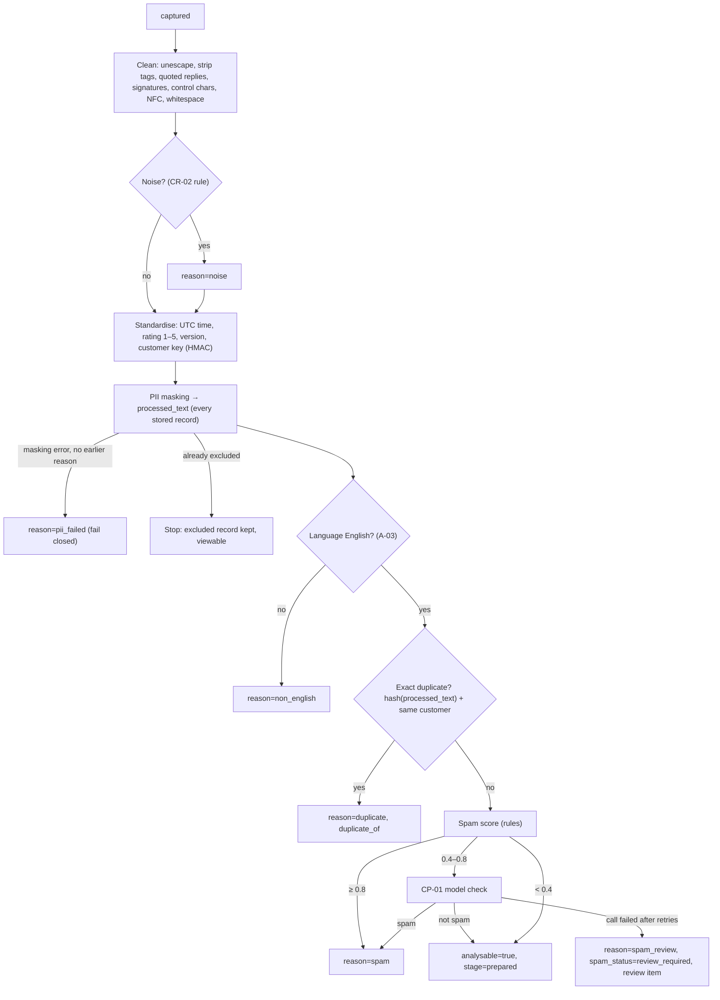

# 06 · Data Ingestion and Preprocessing Pipeline

## 1. Canonical processing sequence

This is the single authoritative order. Every other document refers to it.

| Phase | Job | Order | Owner |
|---|---|---|---|
| Ingestion and preprocessing | `ingest` (one per import) | Upload → validation → cleaning → noise detection → standardisation and customer-key generation → PII masking → language detection → exact-duplicate detection → spam detection → prepared record | SVC-02 to SVC-07 |
| Analysis | `analysis` (one per run) | Run creation → embedding → near-duplicate detection → classification cascade → theme clustering → theme identity matching → override application → theme naming → feature-request aggregation → SQL statistics → persist results → activate the run | SVC-08 to SVC-12, SVC-10 coordinates |

Why this order:

- **Masking before the duplicate hash.** `content_hash` is computed from `processed_text` (masked), so masking must come first; two copies of a complaint that differ only in an e-mail address hash the same.
- **Customer key before duplicates.** Exact duplicates are scoped to the same customer (CR-16), so the key must exist first.
- **Embedding belongs to analysis only.** Imports finish without the model runtime for embeddings; a model change re-embeds inside the next run (DR-04, DR-26). Records imported after the last run have no vector yet; retrieval falls back to full-text for them and the dashboard shows analysis as out of date (FR-DSH-07).
- **Near duplicates need vectors**, so they are detected in analysis and stored per run (not in the import report).
- The SRS lifecycle in SRS §4.2 (L1 to L10) lists logical stages; this physical order differs in two places (de-duplication after masking; near duplicates in analysis). CR-17 records the clarification.

## 2. Ingestion pipeline (Diagram 4)



## 3. Preprocessing pipeline (Diagram 5)



### 3.1 Exclusion precedence and accounting

Each stored record ends preprocessing with exactly one outcome: analysable, one exclusion reason, or processing failed. The reason stored is the **first** that applies in pipeline order:

| Order | Outcome | Stage that sets it | Later stages for this record | Counted in report as |
|---|---|---|---|---|
| 1 | `noise` | Noise detection (cleaned text) | Standardisation and PII masking still run, so the record can be displayed masked; eligibility stages are skipped | filtered: noise |
| 2 | `pii_failed` | PII masking | None; `processed_text` stays empty and the text is shown to non-Owners as "hidden: masking failed" | filtered: PII failed |
| 3 | `non_english` | Language detection | Skipped | filtered: non-English |
| 4 | `duplicate` | Exact-duplicate detection | Skipped; `duplicate_of` set (DR-18) | duplicates |
| 5 | `spam` | Spam detection (rules or CP-01) | – | filtered: spam |
| 6 | `spam_review` | Spam detection when CP-01 could not complete | Held until an Editor resolves the review item or a retry succeeds | filtered: awaiting spam review |
| – | analysable | All stages passed | Eligible for analysis | imported |
| – | failed | Any stage, after 2 retries of a transient error or at once for a permanent error | `stage = failed`, row in `import_row_errors` (kind `failed`) | failed |

If masking fails on a record already excluded as `noise`, the reason stays `noise` and the text is hidden the same way.

**Spam check failure (CR-19).** A failed CP-01 call is never treated as "not spam". The record gets `spam_status = review_required`, `exclusion_reason = spam_review` and a `review_items` row (kind `spam_uncertain`). It is excluded from all statistics, retrieval and generation until an Editor decides, or until `POST /imports/{id}/retry` (API-88) re-runs CP-01 successfully. Resolution sets `spam_status` to `clean` (record becomes analysable) or `spam`.

## 4. Stage specification

| # | Stage | Input | Output | Tool or library | Logic | Destination | Failure behaviour |
|---|---|---|---|---|---|---|---|
| 1 | Upload | Multipart stream | File on disk, hash | FastAPI streaming, `hashlib` | Size cap while streaming | source_files | Over limit → 413, nothing stored |
| 2 | Format and encoding | File | Format, encoding | `charset-normalizer`, `csv.Sniffer`, `json` | Detect from first 64 KB | source_files | Unsupported → file rejected |
| 3 | Mapping | Header row, preview | Mapping | Our code | Required: text column; optional others | column_mappings | Missing text column → cannot start |
| 4 | Row validation | Raw row | Valid row or error | Pydantic | SVC-04 rules | feedback_records or import_row_errors | Rejected row recorded, not stored; continue |
| 5 | Cleaning | raw_text | cleaned text | stdlib `html`, `re`, `unicodedata` | SVC-05 | feedback_records (working column) | Exception → record `failed` after 2 retries |
| 6 | Noise | cleaned text | reason | Our lexicons | CR-02 rule (SVC-05) | exclusion_reason | n/a |
| 7 | Standardisation | Fields | UTC time, rating, version, customer key | `python-dateutil`, `hmac` | SVC-05 | feedback_records, customers | Unparseable date → null + flag (DR-08) |
| 8 | PII masking | cleaned text | processed_text, counts | Presidio + spaCy small model + custom recognisers | SVC-06 | feedback_records | Fail closed (`pii_failed`) |
| 9 | Language | processed_text | language code | Language detector restricted to likely languages (EXP-11) | Short texts below detector confidence → `und`, treated as English if ASCII letters dominate | feedback_records.language | Detector error → `und` |
| 10 | Exact duplicate | content_hash of processed_text, customer key | duplicate_of | SQL lookup | Same customer scope (CR-16) | feedback_records | n/a |
| 11 | Spam | Text, signals | spam_status, score, reason | Rules; CP-01 for the uncertain band | SVC-05 | spam_score, spam_status, exclusion_reason | CP-01 failure → `spam_review` (§3.1) |
| 12 | Report | Counters | Report JSON | SQL | Section 10 | import_jobs.report | Identity mismatch → job `failed` with "reconciliation error" (DR-40) |

Analysis-stage steps (embedding, near duplicates, classification and later) are specified in doc 03 (SVC-08 to SVC-12) and doc 02 WF-D. Their failures are reported per analysis run, never in the import report (§10.2).

## 5. Noise rule (proposed change CR-02)

| Example | A-09 (current) | CR-02 (proposed) |
|---|---|---|
| "app crashes" | Noise (2 words) | Kept (signal term "crashes") |
| "login broken" | Noise | Kept |
| "ok" | Noise | Noise (boilerplate) |
| "👍" | Noise | Noise (no alphabetic word) |
| "nice" | Noise | Kept as praise (emotion lexicon), low analytic weight |

## 6. Spam signals

| Signal | Weight (initial, tuned on seeded data) |
|---|---|
| Contains a URL | 0.3 per URL, max 0.6 |
| Promotional phrases ("buy now", "free coins", "visit") | 0.4 |
| Repeated characters or tokens (more than 5 repeats) | 0.2 |
| All-caps ratio above 0.7 with length above 20 | 0.1 |
| Same text from 5 or more different customers within 24 hours | 0.5 |

## 7. Dataset size feasibility

| Item | Reference workspace (A-05) | Maximum import (A-05) |
|---|---|---|
| Records | 5,000 | 20,000 |
| Raw text storage (average 300 bytes, raw + processed) | ≈ 3 MB [C] | ≈ 12 MB [C] |
| Vectors (1,024 dimensions × 4 bytes, if that is the model's dimension) | ≈ 20 MB [C] | ≈ 82 MB [C] |
| Deterministic stages | Seconds to a few minutes [E] | Minutes [E] |
| PII masking with spaCy small model | Minutes [E] (EXP-10) | Up to tens of minutes [E] |
| Embedding | Minutes [E] (EXP-04) | Tens of minutes [E] |
| LLM classification | See section 8 | See section 8 |

All [E] values must be replaced by measurements (EXP-01, EXP-04, EXP-10) before being quoted.

## 8. Per-record versus batched LLM inference

**Model of the cost.** For one LLM call: time ≈ uncached prompt tokens ÷ prompt speed + output tokens ÷ generation speed + overhead. Ollama reports uncached prompt evaluation separately (`prompt_eval_duration`, "time spent evaluating uncached prompt tokens") and returns `eval_count` and `eval_duration` [V]. So shared instruction prefixes are cached, and real speeds can be measured from responses (EXP-01).

**Illustrative calculation, not a benchmark.** Assumptions marked [E]: generation 30–60 tokens/s, prompt evaluation 500–1,500 tokens/s on the RTX 4060 for a 4B model, call overhead 0.1 s, 100 tokens per record, cached 600-token instruction prefix.

| Strategy | Output per record | Time per record [C from E] | 5,000 records [C from E] | Risks |
|---|---|---|---|---|
| Per-record call, verbose JSON (~40 output tokens) | 40 | ≈ 0.8 to 1.6 s | ≈ 1.1 to 2.2 hours | Slow; simple failure isolation |
| Batched 10 per call, short record keys `r1`…`r10` and enum labels (~20 output tokens per record) | 20 | ≈ 0.4 to 0.9 s | ≈ 35 to 75 minutes | Mis-keyed or skipped items; mitigated by key validation and per-record fallback |
| Cascade: calibrated classifier accepts a share p of records; LLM batches the rest | 20 × (1 − p) | Depends on p | For p = 0.6: ≈ 15 to 30 minutes | Needs labelled training data; classifier quality measured in EXP-09 |

**Decision (ADR-07).** Batched calls with short record keys (CP-02 schema in doc 04 §3), inside a cascade with the calibrated classifier, plus a per-record fallback when batch validation fails. EXP-01 measures the real speeds and the batch size (5, 10, 20) that keeps key accuracy at 100% after validation.

## 9. Recovery and retries

| Situation | Behaviour |
|---|---|
| Worker crash mid-batch | Uncommitted batch rolled back; heartbeat goes stale; job requeued; resumes at the last committed batch (cursor) (DR-39) |
| Transient error (Ollama busy, connection reset) | Job-step backoff 10 s, 40 s; then the record is `failed` (DR-38) |
| Permanent error (bad data) | Record `failed` immediately with reason |
| Retry of an import (API-88) | Reprocesses records with `stage = failed` and re-runs CP-01 for `spam_review` records; inserts are keyed by (import, row, segment), so a retry cannot store a row twice (FR-ING-07) |
| Rule or model change | `reprocess` job from a chosen stage over stored raw text (DR-04); new method versions recorded (DR-34) |

## 10. Import reconciliation (proposed change CR-01)

### 10.1 Import identity

The identity uses DR-40's own terms, each defined so that every row is counted once:

```text
received = imported + rejected + duplicates + filtered + failed

imported   = stored records that are analysable
rejected   = rows that failed validation (not stored)
duplicates = stored records with reason duplicate (exact, same customer)
filtered   = noise + pii_failed + non_english + spam + spam_review
failed     = stored records whose processing failed after retries
```

- The unit is the row for CSV and JSON. For TXT transcripts the unit is the segment created by splitting (DR-27); the report also shows the number of files and segments.
- The check runs at the end of the job; a mismatch fails the job with "reconciliation error" (DR-40, NFR-08).
- `import_jobs.report` is a snapshot at completion. Later changes (an Editor reversing a noise flag, DR-14; a spam review being resolved) do not rewrite it; API-17 returns the snapshot and the current counts side by side.
- AC-ING-01 omits `failed`; CR-01 proposes adding it and adopting these definitions. DR-40 itself is unchanged.

Example report:

| Received | Rejected | Failed | Imported | Duplicates | Noise | PII failed | Non-English | Spam | Awaiting spam review |
|---|---|---|---|---|---|---|---|---|---|
| 5,000 | 31 | 4 | 4,605 | 140 | 88 | 0 | 79 | 46 | 7 |

(31 + 4 + 4,605 + 140 + 88 + 0 + 79 + 46 + 7 = 5,000.)

### 10.2 Analysis-run outcomes (separate from imports)

Each analysis run stores one row per eligible record in `record_classifications` with a `status`, and summary counts in `analysis_runs.report`:

```text
eligible = classified + near_duplicate + unclassified + embedding_failed
```

- `eligible`: records analysable at run start (English, not excluded).
- `embedding_failed`: no vector after 2 retries; excluded from this run only and retried by the next run.
- `near_duplicate`: same customer, cosine ≥ 0.95 to an earlier record (A-10 starting value); linked by `near_duplicate_of`, not counted again (DR-17, DR-18).
- `unclassified`: classifier and LLM both failed; queued for review.
- A failed run never changes the current run; the workspace keeps showing the last successful run (AIR-22).
