# 08 · Database ER Diagram and Relationships

The ER diagrams below match the data dictionary in doc 07 (54 tables). Column details, constraints and indexes are in doc 07; here the focus is entities, keys and cardinality. Because 54 tables do not fit legibly in one picture, section 1 shows the whole model with relationships only (printed on an A3 page in the PDF; zoom in for detail) and sections 2 to 6 show every table with its key columns in 14 smaller diagrams, grouped by domain.

Notation: `||--o{` one to zero-or-many, `||--|{` one to one-or-many, `|o--o{` zero-or-one to zero-or-many, `||--||` one to one, `|o--||` zero-or-one to exactly one.

Tenant scoping is not drawn on every line: every table except `users`, `sessions`, `login_attempts` and `prompt_versions` belongs to exactly one workspace, and every tenant-to-tenant foreign key includes `workspace_id` (doc 07 §2).

## 1. Whole model (Diagram 12)

```mermaid
erDiagram
    users ||--o{ sessions : "signs in with"
    users ||--o{ workspace_memberships : "is member via"
    workspaces ||--o{ workspace_memberships : "has members"
    workspaces ||--o{ data_sources : owns
    workspaces ||--o{ analysis_runs : owns
    workspaces ||--o{ jobs : owns
    workspaces ||--o{ audit_logs : records
    data_sources ||--o{ source_files : receives
    data_sources ||--o{ import_jobs : "imported by"
    source_files |o--o{ import_jobs : "parsed by"
    import_jobs ||--o{ import_row_errors : reports
    import_jobs ||--o{ feedback_records : produces
    customers |o--o{ feedback_records : authored
    feedback_records ||--o{ record_embeddings : "embedded as"
    analysis_runs ||--o{ record_classifications : labels
    feedback_records ||--o{ record_classifications : "labelled in"
    analysis_runs ||--o{ theme_memberships : assigns
    themes ||--o{ theme_memberships : contains
    feedback_records ||--o{ theme_memberships : "member of"
    themes ||--o{ theme_overrides : "corrected by"
    themes ||--o{ theme_run_stats : "measured in"
    analysis_runs ||--o{ theme_run_stats : computes
    aggregated_requests ||--o{ request_memberships : groups
    feedback_records ||--o{ request_memberships : "asks in"
    analysis_runs ||--o{ review_items : raises
    metric_definitions ||--o{ metric_observations : "observed as"
    metric_definitions ||--o{ theme_metric_links : "linked by"
    themes |o--o{ theme_metric_links : "linked to"
    themes |o--o| opportunities : "becomes"
    aggregated_requests |o--o| opportunities : "becomes"
    opportunities ||--o{ score_inputs : "scored by"
    scoring_configs ||--o{ score_snapshots : "applied in"
    opportunities |o--o{ documents : "described by"
    documents ||--|{ document_versions : versions
    documents ||--o{ user_stories : contains
    user_stories ||--o{ acceptance_criteria : has
    documents ||--o{ claims : asserts
    claims ||--|{ claim_evidence : cites
    feedback_records ||--o{ claim_evidence : "cited as"
    claims ||--o{ verification_results : "checked by"
    documents ||--o{ approvals : "approved via"
    roadmaps ||--o{ roadmap_items : contains
    opportunities ||--o{ roadmap_items : "planned as"
    roadmap_items ||--o{ roadmap_dependencies : "depends on"
    score_snapshots |o--o{ roadmaps : "basis of"
    chat_sessions ||--o{ chat_messages : contains
    chat_messages ||--o{ tool_call_records : invokes
    chat_messages ||--o{ claims : asserts
    integration_configs ||--o{ integration_actions : performs
    user_stories ||--o{ integration_actions : "exported by"
    user_stories ||--o| external_item_links : "linked to"
    prompt_versions ||--o{ llm_call_records : "used by"
    jobs ||--o{ llm_call_records : makes
    evaluation_datasets ||--o{ evaluation_items : contains
    evaluation_datasets ||--o{ evaluation_runs : "evaluated in"
    workspaces ||--o{ metric_definitions : defines
    workspaces ||--o{ product_releases : records
    workspaces ||--o{ chat_sessions : hosts
    workspaces ||--o{ integration_configs : configures
    workspaces ||--o{ column_mappings : saves
    login_attempts {
        bigint id PK
        text email_lower "global, no FK"
    }
```

> `login_attempts` is global and keyed by e-mail and IP, so it has no relationships.

## 2. Identity, ingestion and feedback

### 2.1 Identity and workspaces

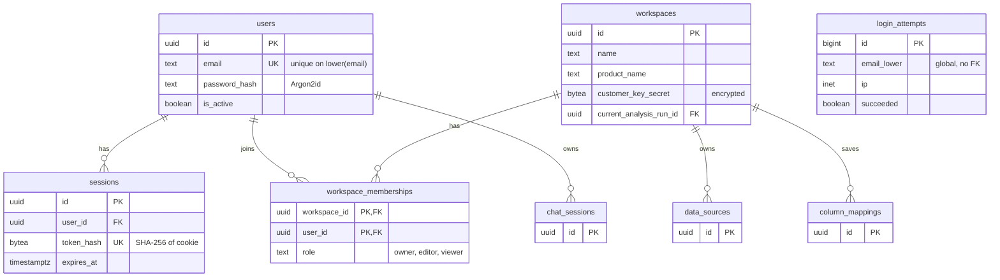

Entities from other areas are shown with their key only: `chat_sessions`, `column_mappings`, `data_sources`.

### 2.2 Sources, files and imports

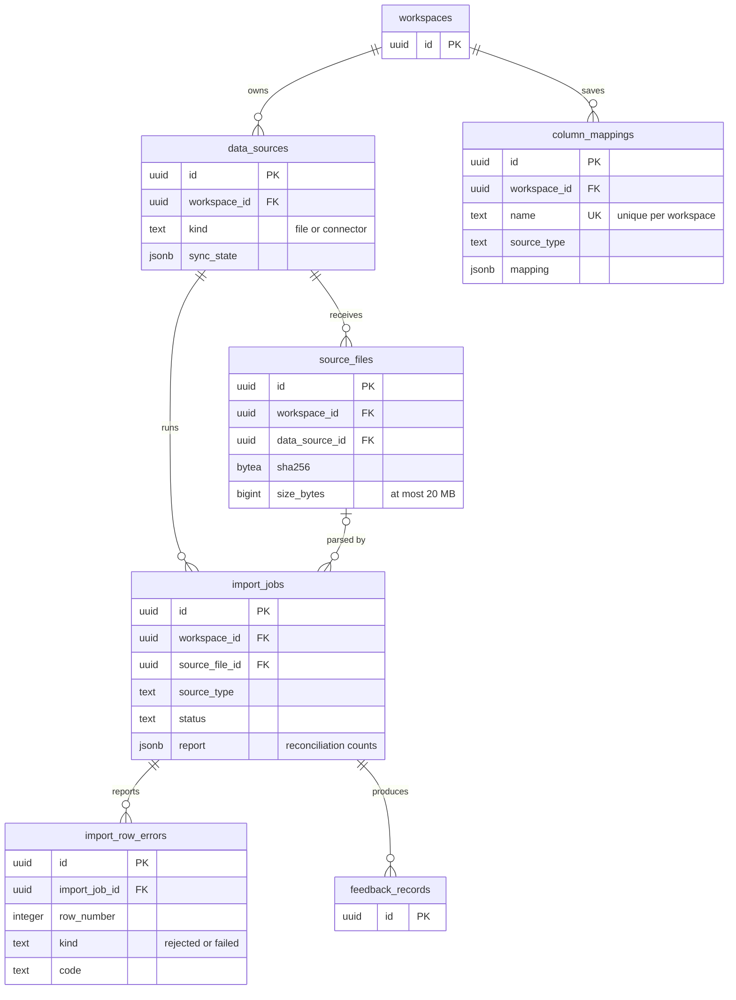

Entities from other areas are shown with their key only: `feedback_records`, `workspaces`.

### 2.3 Feedback records

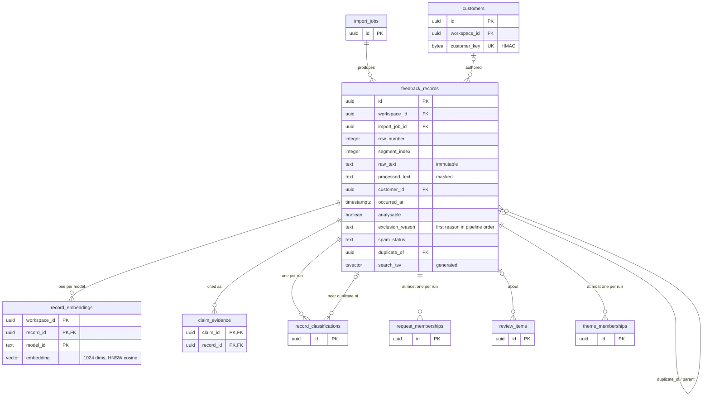

Entities from other areas are shown with their key only: `claim_evidence`, `import_jobs`, `record_classifications`, `request_memberships`, `review_items`, `theme_memberships`.

## 3. AI analysis

### 3.1 Analysis runs and per-record outcomes

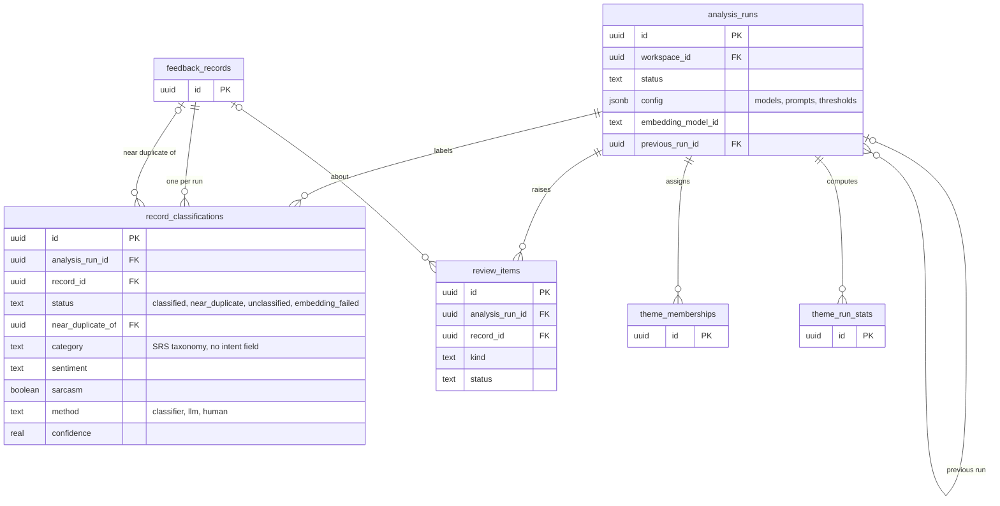

Entities from other areas are shown with their key only: `feedback_records`, `theme_memberships`, `theme_run_stats`.

### 3.2 Themes

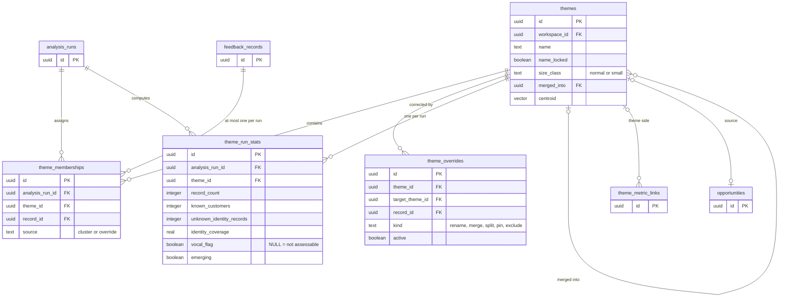

Entities from other areas are shown with their key only: `analysis_runs`, `feedback_records`, `opportunities`, `theme_metric_links`.

### 3.3 Feature requests

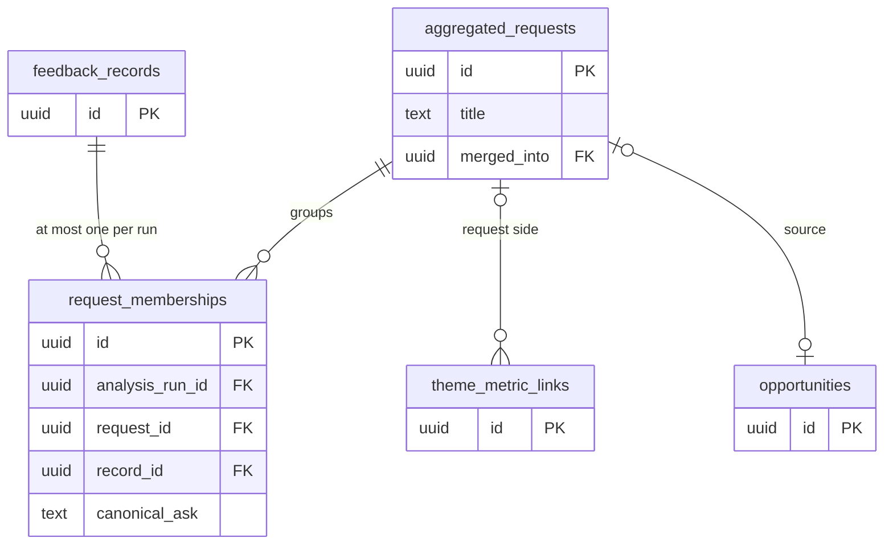

Entities from other areas are shown with their key only: `feedback_records`, `opportunities`, `theme_metric_links`.

## 4. Analytics, prioritisation and roadmaps

### 4.1 Product analytics

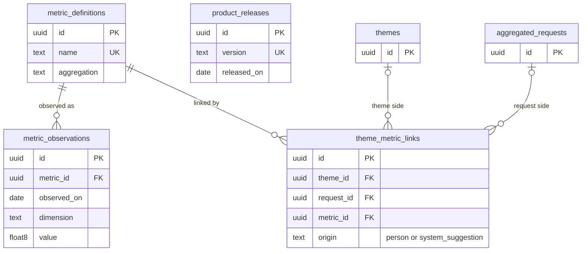

Entities from other areas are shown with their key only: `aggregated_requests`, `themes`.

### 4.2 Prioritisation

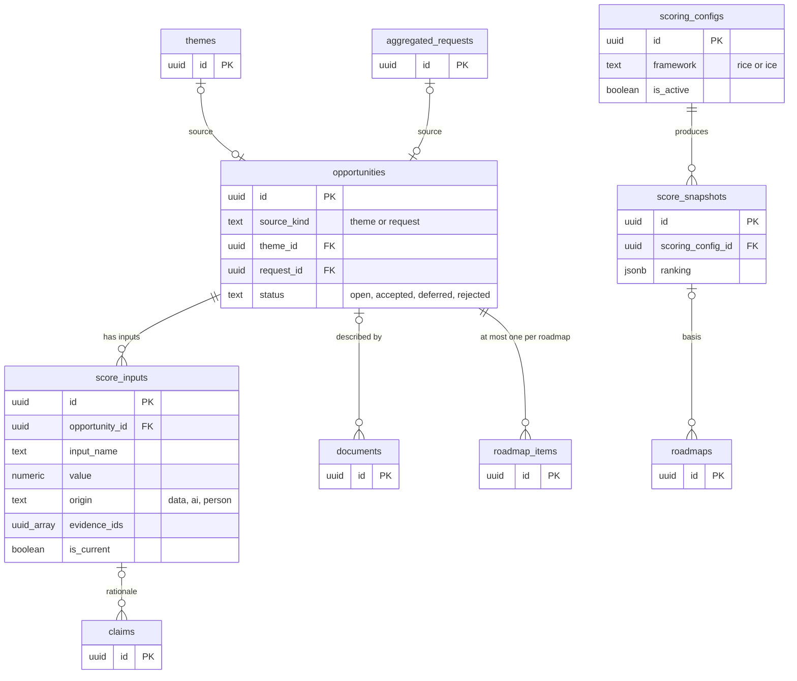

Entities from other areas are shown with their key only: `aggregated_requests`, `claims`, `documents`, `roadmap_items`, `roadmaps`, `themes`.

### 4.3 Roadmaps

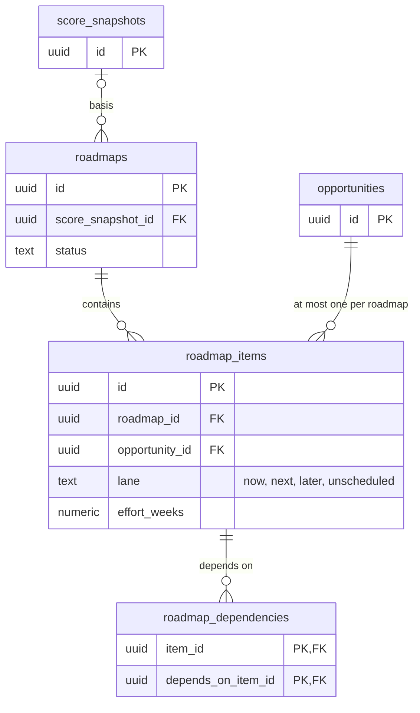

Entities from other areas are shown with their key only: `opportunities`, `score_snapshots`.

## 5. Documents, evidence and approvals

### 5.1 Documents, stories and approvals

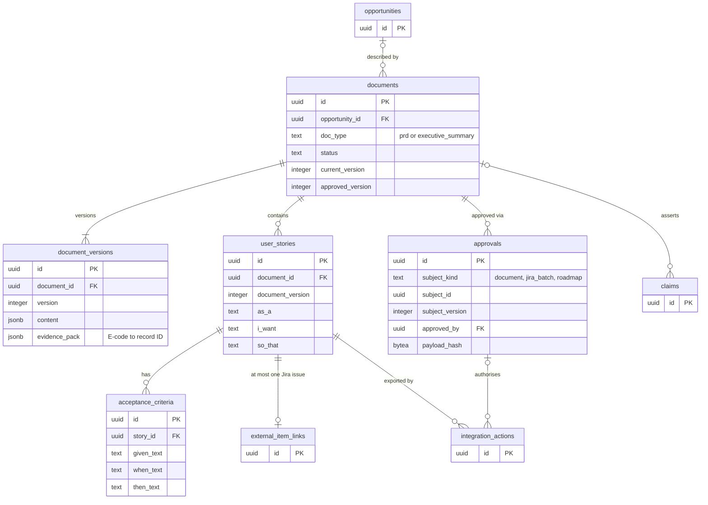

Entities from other areas are shown with their key only: `claims`, `external_item_links`, `integration_actions`, `opportunities`.

### 5.2 Claims and verification

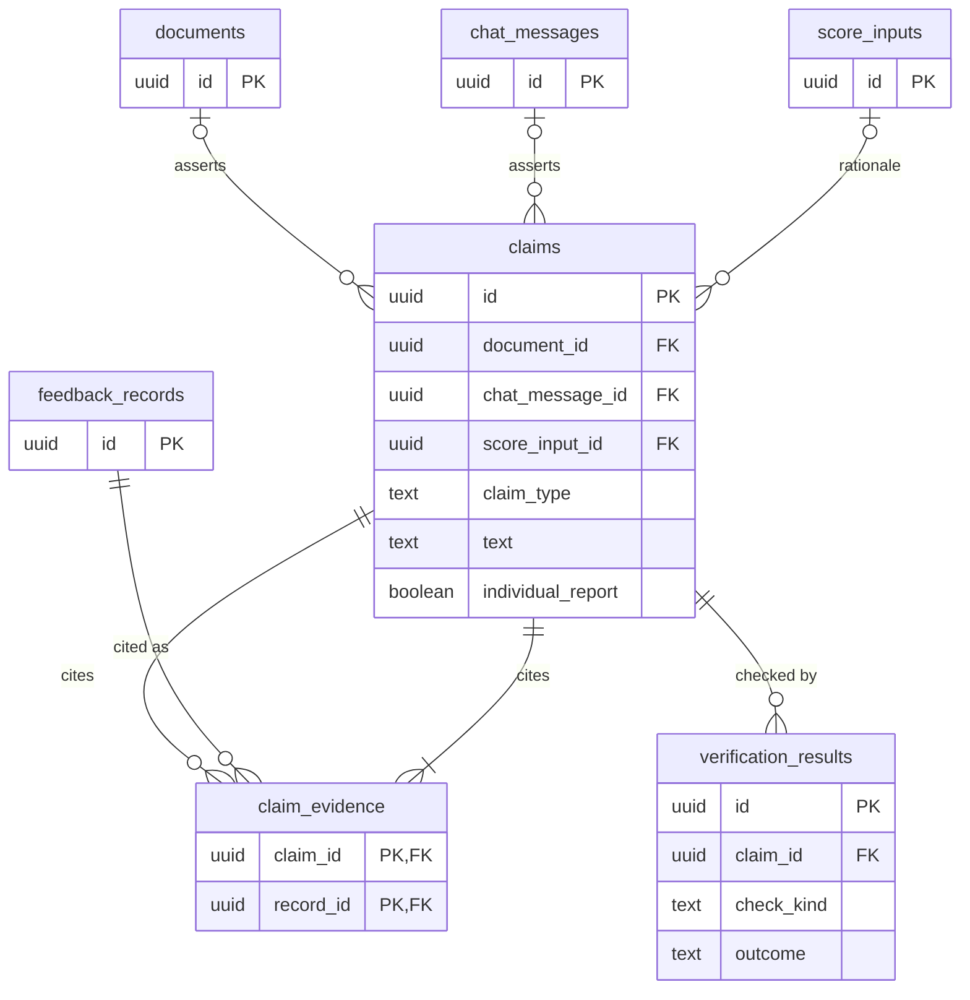

Entities from other areas are shown with their key only: `chat_messages`, `documents`, `feedback_records`, `score_inputs`.

## 6. Assistant, integrations, operations and evaluation

### 6.1 Conversational assistant

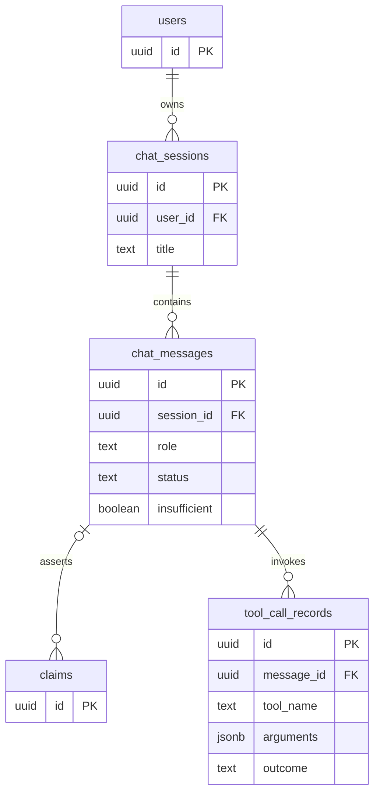

Entities from other areas are shown with their key only: `claims`, `users`.

### 6.2 Jira integration

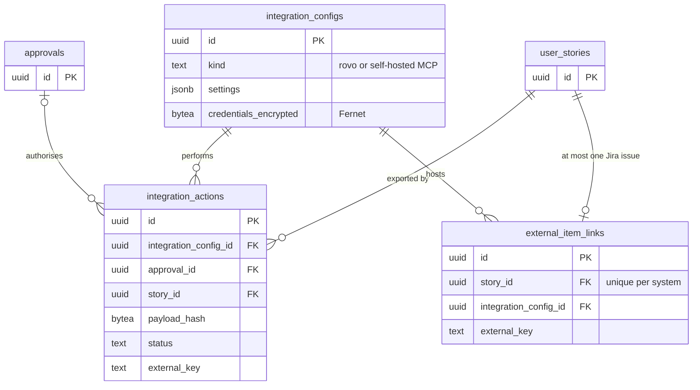

Entities from other areas are shown with their key only: `approvals`, `user_stories`.

### 6.3 Operations, audit and evaluation

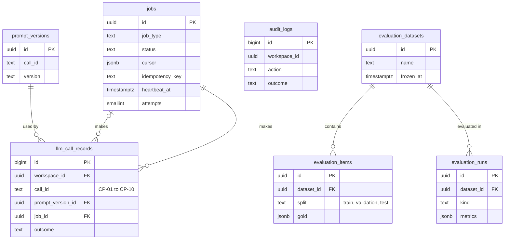

## 7. Cardinality explanation

| Relationship | Cardinality | Why | Enforced by |
|---|---|---|---|
| users – workspaces | Many to many through `workspace_memberships` | A person can belong to several workspaces with a role in each (SEC-21) | Composite PK (workspace_id, user_id) |
| import_jobs – feedback_records | One to many | Each stored record comes from exactly one import row (or transcript segment) | UNIQUE (workspace_id, import_job_id, row_number, segment_index) |
| feedback_records – feedback_records | Self, zero-or-one to many | `duplicate_of` points to the kept original; `parent_record_id` links transcript segments to their transcript | CHECK on duplicate_of; FK |
| customers – feedback_records | Zero-or-one to many | Many sources have no customer identifier; such records have unknown identity and are never counted as customers; statistics report known customers, unknown-identity records and coverage (CR-18) | Nullable FK |
| feedback_records – record_embeddings | One to many | One vector per embedding model, so a model change can be re-embedded side by side (DR-34) | PK (workspace_id, record_id, model_id) |
| analysis_runs – record_classifications | One to many, exactly one row per eligible record per run | Every eligible record ends the run with a status (classified, near duplicate, unclassified, embedding failed); runs are versions, not overwrites | UNIQUE (analysis_run_id, record_id) |
| feedback_records – record_classifications (near duplicate) | Zero-or-one to many | A near duplicate points to the earlier record of the same customer, for that run only; the import report is not changed | CHECK (status = 'near_duplicate' ⇔ near_duplicate_of not null) |
| themes – theme_memberships | One to many, at most one theme per record per run | Clustering gives each record one theme or noise; noise records have no row | UNIQUE (analysis_run_id, record_id) |
| themes – themes | Self, zero-or-one | `merged_into` keeps history after a merge override | FK |
| themes or aggregated_requests – opportunities | Zero-or-one to zero-or-one | An opportunity has exactly one source; each theme or request yields at most one opportunity | CHECK (exactly one source) plus partial unique indexes |
| opportunities – score_inputs | One to many, one current row per input | History of input changes kept; `is_current` selects the live value | Partial UNIQUE (opportunity_id, framework, input_name) WHERE is_current |
| documents – document_versions | One to one-or-many | Every edit or regeneration creates a version; approval points to an exact version | UNIQUE (document_id, version) |
| claims – parent | Exactly one of document, chat message, score input | The same claim and evidence model serves PRDs, chat answers and AI score rationales | CHECK (one non-null parent) |
| claims – feedback_records | Many to many through `claim_evidence` | A claim cites several records; a record supports many claims | PK (claim_id, record_id) |
| roadmaps – opportunities | Many to many through `roadmap_items` | An opportunity appears at most once per roadmap | UNIQUE (roadmap_id, opportunity_id) |
| roadmap_items – roadmap_items | Many to many through `roadmap_dependencies` | Dependencies inside one roadmap; no self links; cycles rejected by SVC-18 | CHECK (item_id <> depends_on_item_id) |
| user_stories – external_item_links | One to zero-or-one per external system | Prevents duplicate Jira issues on retry (AGR-23) | UNIQUE (workspace_id, story_id, external_system) |
| jobs – llm_call_records | Zero-or-one to many | Assistant calls run in-request, so they have no job | Nullable FK |

## 8. Design rationale

- **Composite tenant foreign keys.** RLS hides rows from other workspaces, and composite foreign keys also make it impossible to *store* a cross-workspace reference. Both are cheap and cover different failure modes (a missing `SET LOCAL`, a bug passing the wrong ID).
- **Results keyed by run.** Classifications, memberships and statistics are versioned by `analysis_run_id`, so a re-run never destroys the previous result and dashboards can compare runs. `workspaces.current_analysis_run_id` marks the version shown.
- **Overrides as rows.** Human corrections live in `theme_overrides`, `score_inputs` (origin 'person') and `review_items.resolution`, and are re-applied by every run (FR-THM-12, CR-05).
- **One claim model.** PRDs, chat answers and score rationales all store claims with evidence, so verification and the "show evidence" view work the same everywhere.
- **Derived tables are explicit.** `theme_run_stats` and `score_snapshots` repeat computable facts on purpose: dashboards stay fast and rankings stay reproducible. Only services write them, and each row records the run or configuration it came from.
- **Vectors beside records.** Keeping embeddings in PostgreSQL lets one SQL query join vector search with workspace scope, analysable flag and date filters (doc 05).
