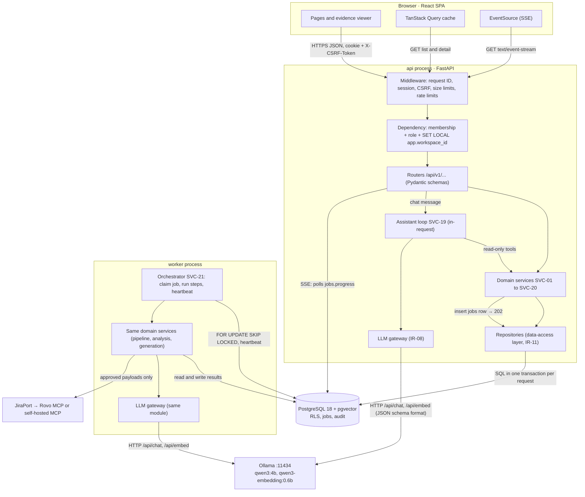

# 09 · API and Service Contracts

Design only. Paths, schemas and codes are the contract for implementation; FastAPI generates the OpenAPI 3.1 description from the Pydantic models (IR-05) [V].

## 1. Conventions

| Topic | Contract |
|---|---|
| Base path | `/api/v1`. Workspace resources live under `/api/v1/workspaces/{ws}/…`. Sequence diagrams in other documents omit this prefix (for example `POST /analysis-runs`) |
| Format | JSON (UTF-8) except file upload (`multipart/form-data`), streams (`text/event-stream`) and exports (`text/markdown`, `text/csv`) |
| Authentication | Session cookie `session` (HttpOnly, Secure when served over HTTPS, SameSite=Lax) holding an opaque random token; the server stores only its SHA-256 (doc 07 `sessions`) |
| CSRF | Unsafe methods (POST, PUT, PATCH, DELETE) require header `X-CSRF-Token` matching the session's CSRF token, returned by `GET /auth/me` |
| Workspace access | Every `{ws}` route: (1) session valid; (2) membership row exists, else **404** (not 403, so workspace IDs cannot be probed); (3) role check (table §5), else **403**; (4) `SET LOCAL app.workspace_id` before any query (doc 07 §5) |
| Roles | O = Owner, E = Editor (and Owner), V = any member (Viewer, Editor, Owner) (SRS §2.4) |
| Identifiers | UUID strings; unknown or other-workspace IDs → 404 |
| Time | ISO 8601 UTC (`2026-10-02T09:14:00Z`); date ranges `from` inclusive, `to` exclusive |
| Pagination | Cursor based: `?limit=50&cursor=<opaque>`; `limit` 1–200, default 50; response `{ "items": [...], "next_cursor": "…" or null }` (IR-07) |
| Filtering and sorting | Query parameters listed per endpoint; unknown parameters → 422 |
| Idempotency | Every 202 endpoint accepts header `Idempotency-Key` (UUID), stored in `jobs.idempotency_key` (unique per workspace and job type); a repeat within 24 h returns the original `JobRef` instead of creating a second job |
| Concurrency | Editable resources return `version`; updates send `base_version`; a mismatch → 409 `version_conflict` |
| Long work | Returns **202** with `{ "job_id", "resource_id" }`; progress via `GET /jobs/{id}` or SSE `GET /jobs/{id}/events` (§7) |
| Limits | Request body ≤ 1 MB except uploads (≤ 20 MB, A-06); chat message ≤ 2,000 characters |

## 2. Error envelope

Every error uses one shape (IR-06). Service exceptions are typed and mapped centrally.

```json
{
  "error": {
    "code": "validation_failed",
    "message": "Column mapping must include a text column.",
    "details": [{"field": "column_mapping.text", "issue": "required"}],
    "request_id": "01JD3Q0Z4M2…"
  }
}
```

| HTTP | `code` values | When |
|---|---|---|
| 400 | `bad_request`, `csrf_missing` | Malformed request; missing CSRF header |
| 401 | `not_authenticated`, `session_expired`, `invalid_credentials` | No or expired session; wrong sign-in |
| 403 | `forbidden_role`, `csrf_invalid` | Member without the required role (logged, AC-AUTH-04) |
| 404 | `not_found` | Unknown resource or not a member |
| 409 | `conflict`, `version_conflict`, `run_in_progress`, `email_taken`, `already_exported`, `not_approved` | State conflicts |
| 413 | `file_too_large` | Upload over 20 MB |
| 415 | `unsupported_format` | Not CSV, JSON or TXT |
| 422 | `validation_failed`, `cycle_detected`, `unacknowledged_claims`, `insufficient_inputs` | Schema or business-rule failure |
| 429 | `too_many_attempts`, `rate_limited` | Sign-in throttling (A-08); per-user limits |
| 500 | `internal_error` | Unexpected; details only in logs with `request_id` |
| 503 | `model_unavailable`, `integration_unavailable` | Ollama or Jira not reachable; the rest of the product keeps working (AIR-22, AGR-25) |

`message` never contains stack traces, SQL, file paths, prompts or customer text.

## 3. Endpoint catalogue

Columns: **Auth** (role, §1), **Mode** (S synchronous, A asynchronous job, SSE stream). Request and response names refer to schemas in §4.

### 3.1 Authentication and workspaces (Module 1)

| ID | Method and path | Purpose | Auth | Mode | Request → Response | Codes | Entities | Services | SRS |
|---|---|---|---|---|---|---|---|---|---|
| API-01 | POST /auth/register | Register | None | S | RegisterIn → UserOut | 201, 409 email_taken, 422 | users, audit_logs | SVC-01 | FR-AUTH-01, SEC-01 |
| API-02 | POST /auth/login | Sign in; sets cookie | None | S | LoginIn → MeOut | 200, 401, 429 | users, sessions, login_attempts | SVC-01 | FR-AUTH-02, SEC-02 |
| API-03 | POST /auth/logout | Delete session | Session | S | – → – | 204 | sessions | SVC-01 | FR-AUTH-03 |
| API-04 | GET /auth/me | Current user, memberships, CSRF token | Session | S | – → MeOut | 200, 401 | users, workspace_memberships | SVC-01 | FR-AUTH-10 |
| API-05 | POST /workspaces | Create workspace (creator becomes Owner) | Session | S | WorkspaceIn → WorkspaceOut | 201, 422 | workspaces, workspace_memberships | SVC-01 | FR-AUTH-05 |
| API-06 | GET /workspaces | List my workspaces | Session | S | – → Page[WorkspaceOut] | 200 | workspaces | SVC-01 | FR-AUTH-10 |
| API-07 | GET /workspaces/{ws} | Workspace and product profile | V | S | – → WorkspaceOut | 200, 404 | workspaces | SVC-01 | FR-AUTH-07 |
| API-08 | PATCH /workspaces/{ws} | Edit name, description, product profile, glossary (CR-07) | O | S | WorkspacePatch → WorkspaceOut | 200, 409, 422 | workspaces | SVC-01 | FR-AUTH-05 |
| API-09 | DELETE /workspaces/{ws} | Delete workspace after typing its name | O | A | {confirm_name} → JobRef | 202, 422 | all tenant tables (cascade) | SVC-01, SVC-21 | FR-AUTH-11 |
| API-10 | GET /workspaces/{ws}/members | List members | V | S | – → Page[MemberOut] | 200 | workspace_memberships | SVC-01 | FR-AUTH-08 |
| API-11 | POST /workspaces/{ws}/members | Add registered user with role | O | S | {email, role} → MemberOut | 201, 404 user, 409 | workspace_memberships | SVC-01 | FR-AUTH-08 |
| API-12 | PATCH /workspaces/{ws}/members/{user_id} | Change role (last Owner protected) | O | S | {role} → MemberOut | 200, 409 | workspace_memberships | SVC-01 | FR-AUTH-09 |
| API-13 | DELETE /workspaces/{ws}/members/{user_id} | Remove member | O | S | – → – | 204, 409 | workspace_memberships | SVC-01 | FR-AUTH-08 |

### 3.2 Ingestion, sources and jobs (Module 2)

| ID | Method and path | Purpose | Auth | Mode | Request → Response | Codes | Entities | Services | SRS |
|---|---|---|---|---|---|---|---|---|---|
| API-14 | POST /workspaces/{ws}/files | Upload a file; returns format, encoding, columns, first 20 rows | E | S | multipart(file) or {pasted_text} → SourceFileOut | 201, 413, 415, 422 | source_files, data_sources | SVC-02 | FR-ING-01, FR-ING-03, FR-ING-10, DR-05, DR-06, DR-10, IR-09 |
| API-15 | POST /workspaces/{ws}/imports | Start import with source type and mapping | E | A | ImportIn → JobRef | 202, 404, 422 | import_jobs, jobs, column_mappings | SVC-03, SVC-21 | FR-ING-02, FR-ING-04, FR-ING-11, DR-01, DR-02 |
| API-16 | GET /workspaces/{ws}/imports | List imports | V | S | ?status → Page[ImportOut] | 200 | import_jobs | SVC-03 | FR-ING-08 |
| API-17 | GET /workspaces/{ws}/imports/{id} | Import status, reconciliation snapshot and current counts | V | S | – → ImportOut | 200, 404 | import_jobs | SVC-03 | FR-ING-05, DR-31, DR-32, DR-40 |
| API-18 | GET /workspaces/{ws}/imports/{id}/errors | Rejected and failed rows | V | S | ?kind&stage → Page[RowErrorOut]; `Accept: text/csv` downloads (formula characters neutralised) | 200 | import_row_errors | SVC-03 | DR-09, DR-37, SEC-12 |
| API-19 | DELETE /workspaces/{ws}/imports/{id} | Remove an import and its records; stale results flagged | O | A | – → JobRef | 202, 409 | feedback_records and dependants | SVC-03, SVC-21 | FR-ING-12 |
| API-88 | POST /workspaces/{ws}/imports/{id}/retry | Reprocess `failed` records, re-run CP-01 for records awaiting spam review, or resume an interrupted import; idempotent per row | E | A | – → JobRef | 202, 409 | import_jobs, feedback_records, jobs | SVC-03, SVC-21 | FR-ING-07, DR-39 |
| API-20 | GET, POST /workspaces/{ws}/column-mappings | List or save mappings | V / E | S | MappingIn → MappingOut | 200, 201, 409 | column_mappings | SVC-03 | FR-ING-11 |
| API-21 | GET, POST /workspaces/{ws}/data-sources | List sources; register a connector (extension, AR-05) | V / O | S | DataSourceIn → DataSourceOut | 200, 201, 422 | data_sources, integration_configs | SVC-02 | FR-ING-01, CR-10 |
| API-22 | POST /workspaces/{ws}/data-sources/{id}/sync | Run a connector sync | E | A | – → JobRef | 202, 409, 503 | jobs, import_jobs | SVC-02, SVC-21 | CR-10 |
| API-23 | GET /workspaces/{ws}/jobs/{id} | Job status and progress | V | S | – → JobOut | 200, 404 | jobs | SVC-21 | AGR-02, NFR-01 |
| API-24 | GET /workspaces/{ws}/jobs/{id}/events | Progress stream | V | SSE | – → events (§6) | 200 | jobs | SVC-21 | IR-09 |
| API-25 | POST /workspaces/{ws}/jobs/{id}/cancel | Cancel at next step boundary | E | S | – → JobOut | 200, 409 | jobs | SVC-21 | AGR-03 |

### 3.3 Feedback drill-down and review

| ID | Method and path | Purpose | Auth | Mode | Request → Response | Codes | Entities | Services | SRS |
|---|---|---|---|---|---|---|---|---|---|
| API-26 | GET /workspaces/{ws}/feedback | Filtered record list (the shared evidence viewer's source) | V | S | ?theme_id&request_id&category&sentiment&source_type&product_version&from&to&analysable&q&run_id → Page[RecordOut] | 200, 422 | feedback_records, record_classifications, theme_memberships | SVC-14, read models | FR-DSH-02, FR-THM-04, IR-03, IR-07, NFR-17 |
| API-27 | GET /workspaces/{ws}/feedback/{id} | Record detail with labels, theme, request, flags; `raw_text` only for Owner (A-22) | V | S | – → RecordDetailOut | 200, 404 | same | read models | FR-ING-06, FR-ING-09, DR-30, DR-33 |
| API-28 | PATCH /workspaces/{ws}/feedback/{id}/flags | Override an exclusion (include a record flagged noise or spam) | E | S | {include: true, reason} → RecordDetailOut | 200, 409 duplicate cannot be included | feedback_records, audit_logs | SVC-05 | DR-14 |
| API-29 | GET /workspaces/{ws}/review-items | Review queue | V | S | ?status&kind → Page[ReviewItemOut] | 200 | review_items | SVC-09 | FR-THM-08, FR-THM-10, FR-AGG-06 |
| API-30 | POST /workspaces/{ws}/review-items/{id}/resolve | Accept or correct a label, sarcasm flag, pair decision or spam review (`spam` or `clean`; `clean` makes the record analysable for the next run) | E | S | {resolution} → ReviewItemOut | 200, 409 | review_items, record_classifications, feedback_records | SVC-09, SVC-12, SVC-05 | AIR-24, DR-13 |

### 3.4 Analysis and themes (Module 4)

| ID | Method and path | Purpose | Auth | Mode | Request → Response | Codes | Entities | Services | SRS |
|---|---|---|---|---|---|---|---|---|---|
| API-31 | POST /workspaces/{ws}/analysis-runs | Run analysis (classification, themes, requests, stats) | E | A | RunIn → JobRef | 202, 409 run_in_progress, 422 no analysable records, 503 | analysis_runs, jobs | SVC-21, SVC-09 to SVC-13 | FR-THM-01 to FR-THM-03, FR-AGG-01 to FR-AGG-03, AGR-01, AGR-05 |
| API-32 | GET /workspaces/{ws}/analysis-runs[/{id}] | Run list or detail (config, counts, timings) | V | S | – → RunOut | 200 | analysis_runs | SVC-21 | DR-34, FR-DSH-07 |
| API-33 | GET /workspaces/{ws}/themes | Themes with stats for a run (default current) | V | S | ?run_id&sort=customers,records,trend&size_class → Page[ThemeOut] | 200 | themes, theme_run_stats | SVC-11 | FR-THM-05, FR-THM-07 ("unassigned" group included) |
| API-34 | GET /workspaces/{ws}/themes/{id} | Theme detail: stats, weekly series, sentiment, representative evidence, vocal and emerging flags | V | S | ?run_id → ThemeDetailOut | 200, 404 | themes, theme_run_stats, theme_memberships | SVC-11, SVC-14 | FR-THM-04 to FR-THM-06 |
| API-35 | POST /workspaces/{ws}/themes/{id}/overrides | Rename, merge, split, pin or exclude records | E | S | OverrideIn → ThemeOut | 201, 409, 422 | theme_overrides, theme_memberships | SVC-11 | FR-THM-09, FR-THM-11, FR-THM-12 |
| API-36 | DELETE /workspaces/{ws}/theme-overrides/{id} | Withdraw an override | E | S | – → – | 204 | theme_overrides | SVC-11 | FR-THM-12 |

### 3.5 Feature requests (Module 5)

| ID | Method and path | Purpose | Auth | Mode | Request → Response | Codes | Entities | Services | SRS |
|---|---|---|---|---|---|---|---|---|---|
| API-37 | GET /workspaces/{ws}/requests | Aggregated requests with counts and customers | V | S | ?run_id&sort&low_confidence → Page[RequestOut] | 200 | aggregated_requests, request_memberships | SVC-12 | FR-AGG-03, FR-AGG-04, FR-AGG-06, FR-AGG-07 |
| API-38 | GET /workspaces/{ws}/requests/{id} | Members with canonical asks and evidence | V | S | – → RequestDetailOut | 200, 404 | same | SVC-12 | FR-AGG-02, FR-AGG-05 |
| API-39 | PATCH /workspaces/{ws}/requests/{id} | Rename (locks title) | E | S | {title} → RequestOut | 200 | aggregated_requests | SVC-12 | FR-AGG-05 |
| API-40 | POST /workspaces/{ws}/requests/{id}/merge | Merge into another request | E | S | {target_id} → RequestOut | 200, 409 | aggregated_requests, request_memberships | SVC-12 | FR-AGG-05 |
| API-41 | POST /workspaces/{ws}/requests/{id}/split | Move records to a new request, or remove them | E | S | {record_ids, new_title or remove:true} → RequestOut | 200, 422 | same | SVC-12 | FR-AGG-05 |

### 3.6 Product analytics and dashboard (Modules 3 and 10)

Metric files are imported with API-15 using `source_type: "metrics"`.

| ID | Method and path | Purpose | Auth | Mode | Request → Response | Codes | Entities | Services | SRS |
|---|---|---|---|---|---|---|---|---|---|
| API-42 | GET /workspaces/{ws}/metrics | Metric definitions | V | S | – → Page[MetricOut] | 200 | metric_definitions | SVC-13 | FR-ANA-01 |
| API-43 | GET /workspaces/{ws}/metrics/{id}/series | Time series with release markers | V | S | ?from&to&dimension&grain=day,week → SeriesOut | 200, 422 | metric_observations, product_releases | SVC-13 | FR-ANA-03, DR-41 |
| API-44 | GET, POST /workspaces/{ws}/releases | List or register releases | V / E | S | ReleaseIn → ReleaseOut | 200, 201, 409 | product_releases | SVC-13 | FR-ANA-02 |
| API-45 | GET, POST /workspaces/{ws}/metric-links; PATCH /…/metric-links/{id} | Link a theme or request to a metric; accept suggestions | V / E | S | MetricLinkIn → MetricLinkOut | 200, 201, 422 | theme_metric_links | SVC-13 | FR-ANA-04, FR-ANA-06 |
| API-46 | GET /workspaces/{ws}/insights/conflicts | Feedback-versus-behaviour conflicts | V | S | ?run_id → Page[ConflictOut] | 200 | theme_run_stats, metric_observations, theme_metric_links | SVC-13 | FR-ANA-05, FR-DSH-08 |
| API-47 | GET /workspaces/{ws}/dashboard | Pain points, trends, top opportunities, freshness | V | S | ?run_id&from&to&source_type&theme_id&product_version → DashboardOut | 200 | read models over run tables, score_snapshots, import_jobs | SVC-13, SVC-15 | FR-DSH-01, FR-DSH-04 to FR-DSH-07 |
| API-48 | GET /workspaces/{ws}/dashboard/export | Dashboard summary as Markdown (A-18) | V | S | ?run_id → text/markdown | 200 | same | SVC-16 renderer | FR-DSH-09 |

### 3.7 Prioritisation (Module 6)

| ID | Method and path | Purpose | Auth | Mode | Request → Response | Codes | Entities | Services | SRS |
|---|---|---|---|---|---|---|---|---|---|
| API-49 | GET, PUT /workspaces/{ws}/scoring-config | Framework (RICE or ICE), scales, confidence rules, capacity | V / E | S | ScoringConfigIn → ScoringConfigOut | 200, 422 | scoring_configs | SVC-15 | FR-PRI-02, FR-PRI-03, FR-PRI-06, NFR-12 |
| API-50 | GET /workspaces/{ws}/opportunities | Opportunities with score, completeness, status | V | S | ?status&sort&complete → Page[OpportunityOut] | 200 | opportunities, score_inputs | SVC-15 | FR-PRI-01, FR-PRI-02 |
| API-51 | POST /workspaces/{ws}/opportunities | Create from a theme or request | E | S | {source_kind, theme_id or request_id} → OpportunityOut | 201, 409 exists | opportunities, score_inputs (data inputs) | SVC-15 | FR-PRI-01 |
| API-52 | GET /workspaces/{ws}/opportunities/{id} | Detail: inputs with provenance, rationale, evidence, explanation | V | S | – → OpportunityDetailOut | 200, 404 | opportunities, score_inputs, claims | SVC-15 | FR-PRI-03, FR-PRI-04, FR-PRI-07 to FR-PRI-10 |
| API-53 | PUT /workspaces/{ws}/opportunities/{id}/inputs/{input_name} | Set an input by a person (never overwritten later) | E | S | {value, rationale?} → OpportunityDetailOut | 200, 422 out_of_range | score_inputs, audit_logs | SVC-15 | FR-PRI-04, FR-PRI-05 |
| API-54 | POST /workspaces/{ws}/opportunities/{id}/suggestions | Queue a `suggest_inputs` job for Impact (CP-05) and/or Effort (CP-10); the worker stores results with origin `ai` and recomputes the ranking; progress via API-24 | E | A | {inputs:["impact","effort"]} → JobRef | 202, 409 suggestion already running, 422 no current analysis run | jobs, score_inputs, claims, llm_call_records | SVC-15, LLM gateway | FR-PRI-07, FR-RMP-02, AIR-08 |
| API-55 | POST /workspaces/{ws}/rankings | Recompute ranking now; returns moved items | E | S | {scoring_config_id?} → RankingOut | 200, 422 insufficient_inputs | score_snapshots | SVC-15 | FR-PRI-05 |
| API-56 | GET /workspaces/{ws}/rankings/{id} | A stored ranking snapshot; `compare_to` gives the diff | V | S | ?compare_to → RankingOut | 200 | score_snapshots | SVC-15 | FR-PRI-05, FR-PRI-08 |
| API-57 | POST /workspaces/{ws}/opportunities/{id}/decision | Accept, defer or reject with reason | E | S | {status, reason} → OpportunityOut | 200, 422 | opportunities, audit_logs | SVC-15 | FR-PRI-11 |

### 3.8 Documents, verification and approvals (Module 7, executive summary of Module 10)

| ID | Method and path | Purpose | Auth | Mode | Request → Response | Codes | Entities | Services | SRS |
|---|---|---|---|---|---|---|---|---|---|
| API-58 | POST /workspaces/{ws}/opportunities/{id}/documents | Generate a PRD | E | A | {doc_type:"prd"} → JobRef | 202, 409 generating, 422 too little evidence, 503 | documents, jobs | SVC-16, SVC-17, SVC-21 | FR-DOC-01 to FR-DOC-06, FR-DOC-12 |
| API-59 | POST /workspaces/{ws}/documents | Generate an executive summary | E | A | {doc_type:"executive_summary", run_id?, from?, to?} → JobRef | 202, 503 | documents, jobs | SVC-16, SVC-17 | FR-DSH-03 |
| API-60 | GET /workspaces/{ws}/documents | List documents | V | S | ?doc_type&status → Page[DocumentOut] | 200 | documents | SVC-16 | FR-DOC-01 |
| API-61 | GET /workspaces/{ws}/documents/{id} | Content of a version with claims and verification | V | S | ?version → DocumentDetailOut | 200, 404 | document_versions, claims, verification_results, user_stories, acceptance_criteria | SVC-16, SVC-17 | FR-DOC-04, FR-DOC-09, AIR-18, AIR-19, NFR-23 |
| API-62 | PATCH /workspaces/{ws}/documents/{id} | Save Editor edits as a new version (re-verification queued) | E | S | DocumentEditIn(base_version) → DocumentDetailOut | 200, 409 version_conflict, 422 | document_versions, claims | SVC-16, SVC-17 | FR-DOC-10 |
| API-63 | POST /workspaces/{ws}/documents/{id}/sections/{section}/regenerate | Regenerate one section | E | A | {instructions?} → JobRef | 202, 409 | documents, jobs | SVC-16 | FR-DOC-06 |
| API-64 | POST /workspaces/{ws}/documents/{id}/verify | Re-run verification on the latest version | E | A | – → JobRef | 202 | verification_results | SVC-17 | AIR-13 to AIR-17 |
| API-65 | GET /workspaces/{ws}/claims/{id}/evidence | Records behind a claim (opens the evidence viewer) | V | S | – → Page[RecordOut] | 200, 404 | claim_evidence, feedback_records | SVC-17 | FR-DOC-07, IR-03, NFR-26 |
| API-66 | POST /workspaces/{ws}/documents/{id}/approve | Approve an exact version; failed or unsupported claims must be acknowledged | E | S | ApproveIn → ApprovalOut | 200, 409 version mismatch, 422 unacknowledged_claims | approvals, documents, audit_logs | SVC-17 | FR-DOC-08, SEC-13, AC-DOC-05 |
| API-67 | GET /workspaces/{ws}/documents/{id}/export | Markdown export (A-18); unapproved drafts are watermarked "Draft" | V | S | ?version → text/markdown | 200 | document_versions | SVC-16 | FR-DOC-11, FR-DSH-09 |

### 3.9 Roadmaps (Module 8)

| ID | Method and path | Purpose | Auth | Mode | Request → Response | Codes | Entities | Services | SRS |
|---|---|---|---|---|---|---|---|---|---|
| API-68 | POST /workspaces/{ws}/roadmaps | Propose a roadmap from a ranking and capacity | E | S | {name, ranking_id?, opportunity_ids?, capacity_per_lane_weeks?} → RoadmapOut | 201, 422 | roadmaps, roadmap_items | SVC-18 | FR-RMP-01, FR-RMP-07 |
| API-69 | GET /workspaces/{ws}/roadmaps[/{id}] | Lanes, items, efforts (estimates labelled), dependency violations, evidence links | V | S | – → RoadmapOut | 200, 404 | roadmaps, roadmap_items, roadmap_dependencies | SVC-18 | FR-RMP-03, FR-RMP-04, FR-RMP-06 |
| API-70 | PATCH /workspaces/{ws}/roadmaps/{id}/items/{item_id} | Move lane or position, set effort (marks manual) | E | S | {lane?, position?, effort_weeks?, base_version} → RoadmapOut | 200, 409, 422 | roadmap_items | SVC-18 | FR-RMP-02, FR-RMP-05 |
| API-71 | POST, DELETE /workspaces/{ws}/roadmaps/{id}/dependencies | Add or remove a dependency | E | S | {item_id, depends_on_item_id} → RoadmapOut | 200, 422 cycle_detected | roadmap_dependencies | SVC-18 | FR-RMP-04 |
| API-72 | POST /workspaces/{ws}/roadmaps/{id}/approve | Approve roadmap version | E | S | {version} → ApprovalOut | 200, 409 | approvals | SVC-18 | Design addition (keeps an agreed version; no SRS change needed) |
| API-73 | GET /workspaces/{ws}/roadmaps/{id}/export | Markdown export | V | S | – → text/markdown | 200 | roadmaps | SVC-18 | A-18 |

### 3.10 Conversational assistant (Module 9)

| ID | Method and path | Purpose | Auth | Mode | Request → Response | Codes | Entities | Services | SRS |
|---|---|---|---|---|---|---|---|---|---|
| API-74 | POST, GET /workspaces/{ws}/chat/sessions | Create or list my sessions | V | S | {title?} → ChatSessionOut | 201, 200 | chat_sessions | SVC-19 | FR-AST-09 |
| API-75 | GET /workspaces/{ws}/chat/sessions/{id}/messages | History with citations and tool trace | V (own session) | S | – → Page[ChatMessageOut] | 200, 404 | chat_messages, tool_call_records, claims | SVC-19 | FR-AST-07, FR-AST-09 |
| API-76 | POST /workspaces/{ws}/chat/sessions/{id}/messages | Ask a question; streamed status, then the verified answer | V | SSE | {content, from?, to?, release?} → events (§6) | 200 stream, 409 previous answer still running, 429, 503 | chat_messages, tool_call_records, claims, llm_call_records | SVC-19, SVC-14, SVC-17 | FR-AST-01 to FR-AST-08, AGR-03, AGR-06 to AGR-11, NFR-04 |
| API-77 | POST /workspaces/{ws}/chat/messages/{id}/feedback | Mark an answer helpful or incorrect | V | S | {feedback} → – | 204 | chat_messages | SVC-19 | FR-AST-10 |

### 3.11 Jira integration

| ID | Method and path | Purpose | Auth | Mode | Request → Response | Codes | Entities | Services | SRS |
|---|---|---|---|---|---|---|---|---|---|
| API-78 | GET, PUT /workspaces/{ws}/integrations/jira | Read or set adapter, site, project, issue type, credentials (write-only, never returned) | O | S | JiraConfigIn → JiraConfigOut | 200, 422 | integration_configs, audit_logs | SVC-20 | AGR-12, AGR-14, AGR-16 |
| API-79 | POST /workspaces/{ws}/integrations/jira/test | Connectivity and permission check (lists projects and issue types) | O | S | – → JiraHealthOut | 200, 503 integration_unavailable | integration_configs | SVC-20 | AGR-14, AGR-15 |
| API-80 | POST /workspaces/{ws}/jira/previews | Preview issues for approved stories (exact payloads) | E | S | {document_id, story_ids} → JiraPreviewOut | 201, 409 not_approved or already_exported | integration_actions | SVC-20 | AGR-17 to AGR-19 |
| API-81 | POST /workspaces/{ws}/jira/previews/{id}/approve | Approve exactly the previewed payloads and send | E | A | {payload_hashes} → JobRef | 202, 409 payload changed | approvals, integration_actions, jobs | SVC-20, SVC-21 | AGR-13, AGR-20 to AGR-22 |
| API-82 | GET /workspaces/{ws}/jira/previews/{id} | Status per story (created, failed, unknown) with Jira keys and links | V | S | – → JiraPreviewOut | 200 | integration_actions, external_item_links | SVC-20 | AGR-23, AGR-24 |
| API-83 | POST /workspaces/{ws}/integration-actions/{id}/reconcile | Resolve an `unknown` result: search Jira for the marker, or link an existing issue key the Editor supplies; only then may a resend be approved | E | A | {external_key?} → JobRef | 202 | integration_actions, external_item_links | SVC-20 | AGR-04, AGR-24 |

### 3.12 Audit, evaluation and health

| ID | Method and path | Purpose | Auth | Mode | Request → Response | Codes | Entities | Services | SRS |
|---|---|---|---|---|---|---|---|---|---|
| API-84 | GET /workspaces/{ws}/audit-logs | Audit trail | O | S | ?action&actor&from&to → Page[AuditOut] | 200 | audit_logs | SVC-22 | SEC-14 to SEC-16 |
| API-85 | POST /workspaces/{ws}/evaluation/datasets | Register a labelled dataset (uploaded file) and freeze splits | O | A | {source_file_id, split_seed} → JobRef | 202, 422 | evaluation_datasets, evaluation_items | SVC-22 | CR-08 |
| API-86 | POST, GET /workspaces/{ws}/evaluation/runs[/{id}] | Run or read an evaluation | O | A / S | {dataset_id, kind} → JobRef; EvalRunOut | 202, 200 | evaluation_runs | SVC-22 | AIR-20, AIR-23, NFR-28 to NFR-30 |
| API-87 | GET /health | Liveness and readiness (database, model runtime, worker heartbeat); no data | None | S | – → {status, checks} | 200, 503 | jobs (heartbeat) | API, SVC-21 | AIR-22, NFR-11 |

## 4. Key schemas

Pydantic-style notation; `?` marks optional fields. All `*_id` are UUIDs.

```text
RegisterIn      { email: str(≤254, email), password: str(12–128), display_name?: str(≤80) }
LoginIn         { email: str, password: str }
MeOut           { user: UserOut, memberships: [{workspace_id, workspace_name, role}], csrf_token: str }
WorkspaceIn     { name: str(1–120), description?: str(≤500) }
WorkspacePatch  { name?, description?, product_name?, product_description?(≤2000), target_users?(≤500), glossary?: {term: definition} }

SourceFileOut   { id, original_filename, size_bytes, detected_format: csv|json|txt, detected_encoding,
                  columns: [str], preview_rows: [[str]](≤20), duplicate_of_file_id?: uuid }
ImportIn        { source_file_id, source_type: review|ticket|feature_request|transcript|other|metrics,
                  column_mapping?: {text: col, occurred_at?: col, customer_id?: col, rating?: col,
                                    product_version?: col, source_record_id?: col, speaker?: col,
                                    metric_name?: col, metric_value?: col, dimension?: col},
                  column_mapping_id?: uuid, save_mapping_as?: str }      # exactly one of mapping or mapping_id
JobRef          { job_id, resource_id, status: "queued" }
ImportOut       { id, status: queued|processing|completed|completed_with_errors|failed|cancelled,
                  source_type, submitted_by, started_at?, finished_at?,
                  report?: {                                              # snapshot at completion, doc 06 §10.1
                    received, rejected, failed, imported, duplicates,
                    filtered: {noise, pii_failed, non_english, spam, spam_review},
                    identity_holds: bool, unit: "row" | "segment", pii_masked_by_type: {…}, languages: {…} },
                  current?: { imported, duplicates, filtered: {…} } }    # live counts after later reviews (DR-14)
RecordOut       { id, source_type, processed_text?: str (null when masking failed), occurred_at?, rating?, product_version?,
                  customer_ref?: str(short hash), identity_known: bool,
                  category?: bug_report|feature_request|usability_issue|performance_issue|praise|question|other,
                  sentiment?: positive|neutral|negative|mixed, sarcasm?, confidence?, theme_id?, request_id?,
                  analysable, exclusion_reason?: noise|pii_failed|non_english|duplicate|spam|spam_review,
                  spam_status: not_checked|clean|spam|review_required, run_status?: classified|near_duplicate|unclassified|embedding_failed }
RecordDetailOut RecordOut + { raw_text?: str (Owner only), pii_counts, spam_score?, duplicate_of?, near_duplicate_of?, import_job_id, row_number }

RunIn           { from?: datetime, to?: datetime }                        # scope; thresholds come from the workspace config
ThemeOut        { id, name, description, size_class, record_count, known_customers, unknown_identity_records,
                  identity_coverage, share, trend: up|flat|down, vocal_flag: bool | null (not assessable), emerging,
                  sentiment: {positive, neutral, negative, mixed} }
ThemeDetailOut  ThemeOut + { weekly: [{week, n}], evidence: [RecordOut](≤10), overrides: [OverrideOut], linked_metrics: [...] }
OverrideIn      { kind: rename|merge|split|pin_record|exclude_record, new_name?, target_theme_id?, record_ids?: [uuid] }
RequestOut      { id, title, record_count, known_customers, unknown_identity_records, identity_coverage, low_confidence_members: int }

OpportunityOut  { id, title, source_kind, theme_id?, request_id?, status, framework, score?: float, rank?: int, complete: bool }
OpportunityDetailOut OpportunityOut + { inputs: [{input_name, value, origin: data|ai|person, rationale?, evidence?: [RecordOut],
                  set_by?, set_at, history: [{value, origin, set_by?, set_at, superseded_at?}]}],
                  reach_identity_coverage: float, confidence_factors: [str],      # rubric reasons, SVC-15
                  pending_suggestion?: {input_name, value, rationale},            # AI value not applied over a person value
                  explanation?: [{input_name, contribution}] }
RankingOut      { id, computed_at, items: [{opportunity_id, title, score, rank, previous_rank?}], moved: [opportunity_id] }

DocumentOut     { id, doc_type, title, status: generating|draft|approved|generation_failed, current_version, approved_version? }
DocumentDetailOut DocumentOut + { version, sections: [{key, heading, blocks: [{text, claim_ids: [uuid]}]}],
                  claims: [{id, claim_type, text, quote?, individual_report, evidence_count,
                            checks: [{check_kind, outcome, detail?}]}],
                  stories: [{id, title, as_a, i_want, so_that, criteria: [{given, when, then}]}] }
DocumentEditIn  { base_version: int, sections: [{key, blocks: [{text}]}], change_note?: str }
ApproveIn       { version: int, acknowledged_claim_ids: [uuid], note?: str }
ApprovalOut     { id, subject_kind, subject_id, subject_version, approved_by, approved_at }

RoadmapOut      { id, name, status, version, capacity_per_lane_weeks,
                  lanes: {now|next|later|unscheduled: [{item_id, opportunity_id, title, score, effort_weeks?,
                           effort_origin?, manual_position, evidence_count}]},
                  violations: [{item_id, depends_on_item_id, reason}] }

ChatMessageOut  { id, role, content, status, insufficient, citations: [{code: "E3", record_id}],
                  tools: [{tool_name, outcome, duration_ms}], feedback? }
JiraConfigIn    { adapter: rovo_mcp|selfhosted_mcp, site_url, project_key, issue_type?, auth: {kind: oauth|api_token, email?, token?} }
JiraPreviewOut  { id, items: [{story_id, payload: {summary, description, issue_type, labels}, payload_hash,
                  status, external_key?, external_url?, error?}] }
```

## 5. Authorisation matrix (summary)

| Action group | Owner | Editor | Viewer |
|---|---|---|---|
| Read everything in the workspace (masked text) | ✓ | ✓ | ✓ |
| Read raw text (A-22) | ✓ | – | – |
| Import, analyse, correct themes and requests, set scores, generate and edit documents, roadmaps, approve documents | ✓ | ✓ | – |
| Send to Jira after preview | ✓ | ✓ | – |
| Members, workspace settings, integrations, delete import or workspace, audit log, evaluation | ✓ | – | – |
| Ask the assistant | ✓ | ✓ | ✓ |

Every refused attempt writes an `audit_logs` row with outcome `failure` (AC-AUTH-04).

## 6. Synchronous, asynchronous and streamed communication

| Pattern | Used for | Why |
|---|---|---|
| **Synchronous request/response** | Reads, CRUD, overrides, score edits, ranking recompute, roadmap edits, approvals, Jira preview | Pure database and arithmetic work; well under a second on expected volumes (NFR targets are proposals until measured) |
| **Asynchronous job** (202 + `jobs` row) | Import, analysis run, document generation, section regeneration, verification, AI score suggestions, connector sync, Jira send, reconcile, deletes, evaluation | Minutes of model work; must survive browser closure and restarts; one worker processes one model task at a time (OLLAMA_NUM_PARALLEL 1) |
| **Server-Sent Events** | Job progress (`/jobs/{id}/events`) and assistant answers | One-way server→browser updates over plain HTTP with automatic reconnection; WebSockets not needed because the browser never streams to the server |
| **In-request model work** | Assistant only | Interactive; a strict 5-minute deadline from request start (A-16) bounds every model call, tool call and verification, with ≤ 4 model turns and ≤ 6 tool calls, so it does not need durable state (doc 04 §5.2) |

Job progress events (`event:` name → `data:` JSON):

```text
progress   {"job_id","step":"classify","done":1200,"total":5000,"message":"Classifying records"}
warning    {"job_id","code":"model_slow","message":"…"}
completed  {"job_id","status":"succeeded","resource_id"}
failed     {"job_id","status":"failed","code":"model_unavailable","message":"…"}
```

Assistant stream:

```text
status     {"phase":"planning"|"tool"|"composing"|"verifying"}
tool       {"tool_name":"list_themes","outcome":"ok","duration_ms":41}
answer     {"message_id","content","citations":[…],"insufficient":false,"complete":true|false,"incomplete_reason":null|"deadline"|"turn_limit"|"tool_limit"}
error      {"code":"timeout","message":"…"}
```

The answer is sent only after verification (doc 05), so unverified text is never streamed token by token. The stream sends a comment line every 15 s to keep proxies from closing it. On reconnect the client reads `GET /jobs/{id}` (or the message) instead of relying on replay.

## 7. API and service communication (Diagram 13)



## 8. Internal service interfaces

Services are Python modules called in-process; the boundaries below are what tests mock. Signatures are design pseudocode.

```python
class LLMGateway(Protocol):                       # the only path to the model runtime (IR-08)
    def structured(self, call_id: str, messages: list[Msg], schema: type[BaseModel],
                   *, model: str, num_ctx: int, timeout_s: int, think: bool = False,
                   logprobs: bool = False, workspace_id: UUID, job_id: UUID | None) -> StructuredResult: ...
        # validates against schema; one repair retry; records llm_call_records; raises ModelUnavailable, InvalidOutput
    def chat_with_tools(self, messages: list[Msg], tools: list[ToolSpec], *, model: str,
                        timeout_s: int, workspace_id: UUID) -> AssistantTurn: ...
    def embed(self, texts: list[str], *, model: str, workspace_id: UUID) -> list[list[float]]: ...

class RetrievalService(Protocol):                 # SVC-14
    def search(self, ws: UUID, query: str, *, filters: RecordFilter, k: int = 12,
               per_customer_cap: int = 2, token_budget: int) -> EvidencePack: ...
    def evidence_for_theme(self, ws: UUID, theme_id: UUID, run_id: UUID, k: int) -> EvidencePack: ...

class VerificationService(Protocol):              # SVC-17
    def verify(self, ws: UUID, claims: list[DraftClaim], pack: EvidencePack) -> list[ClaimCheck]: ...
    def resolve_placeholders(self, ws: UUID, text: str, run_id: UUID) -> str: ...   # raises UnknownPlaceholder

class JobQueue(Protocol):                         # SVC-21
    def enqueue(self, ws: UUID, job_type: str, payload: dict, *, idempotency_key: str | None) -> UUID: ...
    def claim(self, worker_id: str) -> Job | None: ...
    def checkpoint(self, job: Job, cursor: dict, progress: dict) -> None: ...      # same transaction as step writes
    def finish(self, job: Job, status: str, error: str | None = None) -> None: ...

class JiraPort(Protocol):                         # SVC-20, adapters: RovoMcpAdapter, SelfHostedMcpAdapter
    def check(self) -> JiraHealth: ...
    def create_issue(self, payload: IssuePayload, marker: str) -> CreatedIssue: ...  # raises OutcomeUnknown on timeout
    def find_by_marker(self, project_key: str, marker: str) -> CreatedIssue | None: ...

class SourceAdapter(Protocol):                    # doc 01 §4
    def describe(self) -> SourceInfo: ...
    def fetch(self, cursor: dict | None) -> Iterator[tuple[list[RawRow], dict]]: ...   # rows plus next cursor
```

| Caller → callee | Contract | Failure contract |
|---|---|---|
| Routers → domain services | Typed DTOs, `workspace_id` explicit on every call | Typed exceptions (`NotFound`, `Conflict`, `ValidationFailed`, `ModelUnavailable`) mapped by §2 |
| Domain services → repositories | Repository methods take `workspace_id`; queries always filter by it (defence in depth with RLS) | Database errors bubble as `internal_error` except unique violations → `Conflict` |
| Worker steps → gateway | `structured()` with the CP spec from doc 04 | `InvalidOutput` after repair → fallback path in doc 04; `ModelUnavailable` → job `retry_wait` with backoff |
| Assistant → tools | Tool arguments validated by Pydantic; tools are read-only functions over services | Validation error returned to the model as a tool result (counts toward the 6-call limit) |
| SVC-20 → JiraPort | Only `integration_actions` rows in status `approved` with matching `payload_hash` | `OutcomeUnknown` → status `unknown`, reconcile before retry |
